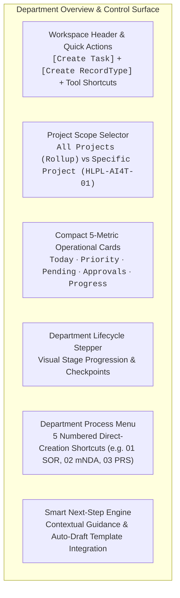
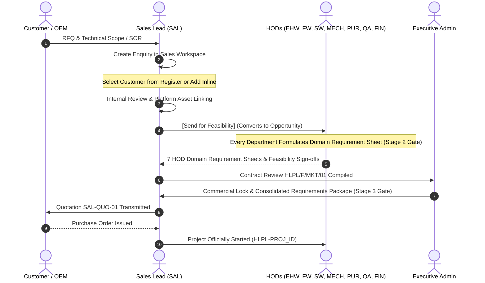

# SSM One - Web Portal Implementation Plan

> Latest decision and evidence checkpoint: see section 15 of [the consolidated handoff](docs/ANTIGRAVITY_READY_TO_USE_CONSOLIDATED_HANDOFF_2026-10-21.md). Its 26 October decisions supersede older UI alternatives; its completion ledger distinguishes tested changes, live deployment and outstanding acceptance. The final prompt in that file remains the one execution prompt.

## Plan Boundary

This document is the detailed implementation subplan for the SSM One web portal and backend. The cross-platform authority is the [SSM-new root master plan](../SSM_ONE_MASTER_PLAN.md); this web plan must follow its shared department names, platform contracts, delivery gates, and acceptance rules. It specifies the portal architecture, operational flows, data schemas, department ownership, document controls, and web delivery roadmap.

The target is the connected Lovable project `a3399684-daab-4b38-8666-187b96b451af`, managed Supabase PostgreSQL backend, and private Cloud Storage. Web/Supabase owns identities, role permissions, operational records, official document numbering (`HLPL-[PROJ_ID]-[DEPT]-[DOC_TYPE]-[REV]`), transactions, immutable audit logs, automation triggers, and private document storage.

Evidence generated or imported for web source belongs in `docs/evidence/`. Shared product decisions live in the project-root master plan; this file contains the detailed web implementation requirements.

---

## 1. Authority and How to Use This Plan

1. **Plan hierarchy**: The project-root [SSM_ONE_MASTER_PLAN.md](../SSM_ONE_MASTER_PLAN.md) is the shared cross-platform authority. This document governs detailed web implementation only. Historical web plans and temporary notes are source material for reconciliation, not parallel active instructions.
2. **Automotive & Enterprise Standards**:
   - **IATF 16949:2016** & **ISO 9001:2015**: Quality management, customer-oriented processes (COP), contract review gates, design verification (DVP&R), PPAP Level 3, and full part traceability.
   - **AIS-140 / TAC**: Telematics and emergency system certification (ARAI/ICAT).
   - **AEC-Q100 / AEC-Q200**: Automotive grade qualification for ICs and passive components.
   - **ISO 7637-2**: Electrical transient conduction along supply lines.
   - **ISO 14001:2015** & **ISO 45001:2018**: Environmental and occupational health/safety.
   - **ISO/IEC 27001:2022**: Information security management and bilateral mutual NDA controls.
3. **Core Architectural Invariants**:
   - Canonical Document ID Formula: $\text{Document ID} = \mathbf{HLPL-[\text{PROJ\_ID}]-[\text{DEPT}]-[\text{DOC\_TYPE}]-[\text{REV}]}$.
   - Master Plan §5: Decoupled Project vs. PCB vs. Wiring Harness vs. Firmware vs. Enclosure architecture with automated development process skips.
   - Symmetrical 4-group departmental Drive (`01 Common documents`, `02 Internal projects`, `03 Client projects`, `04 Other department work`).
   - Human-in-the-loop governance: Protected quality releases and commercial commitments always require recorded human sign-off.

### 1.4 Operational Enterprise Baseline & Clean UI Standard
- **Elimination of Demo/Fictional Markers**: All `"DEMO DATA ONLY"`, `"fictional"`, and `"simulated"` markers are permanently retired. The portal operates exclusively on authentic automotive master records (`Tata Motors Limited · EV Fleet Division`, `Ashok Leyland Limited`, `Select Motors Limited`, `Mahindra Electric Mobility Limited`).
- **Compact Dashboard Typography**: Dashboards adhere to high information density without vertical clutter: compact single-line headers, standard responsive grid containers, and clear inter-section spacing with dual light/dark theme support.

---

## 2. One Portal, Twelve Functional Departments

The digital backbone integrates twelve canonical automotive departments. Every employee accesses permitted work, tasks, documents, and notifications through the same unified records, filtered by department ownership.

```mermaid
graph TD
    CC["Executive Command Center<br/>Admin & HOD Overview · Daily Checklist · RACI Matrix"]
    
    subgraph Commercial & Governance ["Commercial, Quality & Governance"]
        SAL["1. SAL: Sales & Business Development<br/>CRM · Enquiries · Feasibility · Quotations"]
        QA["7. QA: Quality Assurance & APQP<br/>IATF 16949 · DVP&R · PPAP L3 · TAC Cert"]
        FIN["10. FIN: Accounts & Finance<br/>Costing · Tax Invoices · Budgets · Ledger"]
        HROPS["12. HR/OPS: HR & Operations<br/>Skill Matrix · QMS · Corporate Legal & Letterheads"]
    end

    subgraph Engineering & Design ["Product Engineering & Design"]
        EHW["2. EHW: Embedded Hardware Engineering<br/>Schematics · PCB Layout · BOM · DFMEA"]
        FW["3. FW: Embedded Firmware Engineering<br/>RTOS Kernel · HAL Drivers · Bootloader · FOTA"]
        SW["4. SW: Cloud & Application Software<br/>Telematics Backend · Protocols · BLE · GUI Tools"]
        MECH["5. MECH: Mechanical Engineering<br/>IP67 Enclosures · Harness Drawings · Thermal CAD"]
    end

    subgraph Supply & Manufacturing ["Procurement, Manufacturing & Service"]
        PUR["6. PUR: Purchasing & Supply Chain<br/>Dual-Track Proto/Mass · AVL · POs · Stores"]
        EMF["8. EMF: Electronics Manufacturing<br/>Outsourced PCBA receipt · Box-build · Packaging"]
        MMF["9. MMF: Mechanical Manufacturing<br/>Mechanical fabrication · Finishing · Subassembly"]
        SIT["11. SIT: Service & IT Infrastructure<br/>Cloud Drive · Telematics Server · Field RMA"]
    end

    CC --> SAL & QA & FIN & HROPS
    CC --> EHW & FW & SW & MECH
    CC --> PUR & EMF & MMF & SIT
```



| Department Code | Full Department Title | Primary Record Type | Core Operational Ownership & Deliverables |
|---|---|---|---|
| **SAL** | Sales & Business Development | `Enquiry` | Customer Register.xlsx, RFQ intake, SOR analysis (`SAL-SOR-01`), bilateral mNDA (`SAL-mNDA-01`), contract reviews (`HLPL/F/MKT/01`), quotations (`SAL-QUO-01`), customer purchase orders (`SAL-PO-01`). |
| **EHW** | Embedded Hardware Engineering | `PRS` | System architecture, Hardware PRS (`EHW-PRS-01`), schematics (`EHW-SCH-01`), preliminary/frozen BOMs (`EHW-BOM-01`), hardware DFMEA (`EHW-DFMEA-01`), Gerber archives, AEC-Q100 compliance. |
| **FW** | Embedded Firmware Engineering | `Firmware release` | Low-level MCU firmware, Firmware Requirements (`FW-FRS-01`), Bootloader, RTOS kernel bring-up, HAL peripheral drivers, CAN/LIN protocol stack, secure dual-bank FOTA, cryptographic binary signing (`FW-BIN-01`). |
| **SW** | Cloud & Application Software | `Software package` | Telematics application software, Software Requirements (`SW-SRS-01`), AIS-140/MQTT/HTTP protocol engine, BLE 5.2 mobile companion app, cloud API contracts, desktop diagnostic & flashing GUI tools (`SW-TOOL-01`). |
| **MECH** | Mechanical Engineering | `Mechanical CAD` | Mechanical Requirements (`MECH-MRS-01`), 3D CAD modeling, IP67 enclosure tooling (`ENC-MECH-CAD-01`), wiring harness pinout drawings (`HARN-MECH-DWG-01`), thermal CFD simulation, vibration fixture design. |
| **PUR** | Purchasing & SCM | `Purchase order` | Sourcing Feasibility (`PUR-SRS-01`), Approved Vendor List (AVL), dual-track sourcing (Proto soft-tooling vs Mass production), PR/RFQ/PO issuance, supplier PPAP Level 3 review, stock allocation. |
| **QA** | Quality Assurance & APQP | `Quality inspection` | Quality & DVP&R Requirements (`QA-QRS-01`), APQP roadmap (`HLPL-APQP-001`), DVP&R matrix (`QA-DVP-01`, 18 electrical/environmental tests), ISO 7637-2 compliance, iCAT Type Approval TAC cert (`QA-TAC-01`), NCR/CAPA logs. |
| **EMF** | Electronics Manufacturing | `Production traveler` | Electronics manufacturing requirements (`EMF-MPR-01`), receipt/traceability of accepted outsourced PCBAs, enclosure integration and box-build, harness/accessory installation, controlled firmware loading, in-line/final checks, packaging and production traveler. In-house SMT/PCBA assembly is out of scope. |
| **MMF** | Mechanical Manufacturing | `Mechanical production traveler` | Mechanical manufacturing requirements (`MMF-MPR-01`), enclosure/part fabrication or controlled supplier receipt, finishing, mechanical subassembly, fit/dimensional checks, tooling and handoff to EMF for final electronics integration. |
| **FIN** | Accounts & Finance | `Commercial quotation` | Financial Feasibility & Cost Model (`FIN-CFS-01`), project budget tracking, commercial margin analysis, milestone billing, GST/HSN tax invoices (`FIN-INV-01`), payment reconciliation. |
| **SIT** | Service & IT Infrastructure | `Service ticket` | Infrastructure Requirements (`SIT-SRS-01`), enterprise Cloud Drive storage, telematics backend gateway, OTA server monitoring, role-based access control, field vehicle mounting checklist (`SIT-MNT-01`), RMA ticketing. |
| **HR/OPS** | HR & Operations | `Audit report` | Competency & Safety Requirements (`HROPS-CRS-01`), employee competence matrix (`HLPL/F/HR/03`), QMS internal audits, Six Sigma DMAIC registers, Signed-In Company Directory, Corporate Legal Documents & Letterheads. |

---

## 3. Command Center, Personas & Role-Switching Governance

### 3.1 Role & Persona Switcher
The portal incorporates an instant **Role & Persona Switcher** in the header allowing 1-click verification of department context, permission boundaries, and filtered queues:
1. **Executive Admin / MD**: Master authority, full cross-department rollup, system template configuration, and PMSS override.
2. **12 Department Roles**:
   - `SAL Lead`: Priya Sharma (Sales & BD)
   - `EHW Lead`: Avery Vale (Embedded Hardware Engineering)
   - `FW Lead`: Devon Lane (Embedded Firmware Engineering)
   - `SW Lead`: Maya Lin (Cloud & Application Software Engineering)
   - `MECH Lead`: Samira Holt (Mechanical Engineering)
   - `PUR Lead`: Morgan Reed (Purchasing & SCM)
   - `QA Lead`: Jordan Blake (Quality Assurance)
   - `EMF Lead`: Casey Rowan (Electronics Manufacturing)
   - `MMF Lead`: Owner TBD; do not reuse the former TST persona without owner approval
   - `FIN Lead`: Priya Voss (Finance & Accounts)
   - `SIT Lead`: Kai Morgan (Service & IT Infrastructure)
   - `HR Lead`: Taylor Quinn (HR & Operations)
3. **Client Portal Persona**: Rohan Verma (Tata Motors Fleet Manager) — restricted customer view displaying order tracking, published TAC certificates, and customer ticket status.

When switched, the portal displays a persistent active persona banner with a 1-click `[Switch Back to Admin]` button. Every persona change is audited in the immutable event log.

### 3.2 Executive Command Center Overview
The **Home / Command Center** serves as the compact operational hub:
- **Header Action Bar**: Unified `[Create Task]`, `[Cross-Department Sync]`, `[Auto-Draft Templates]`, and `[Platform Asset Library]` actions.
- **Executive KPI Cards**: 6 responsive compact metrics tracking Active Project, Order Volume, Revenue, Stage, Audit Score, and System Sync.
- **Nine-Stage Project Stepper**: Real-time project milestone tracking with 1-click stage inspection.
- **Two-Column Daily Task Checklist**:
  - Left Lane: *Today's Action Items* with quick complete and status toggles.
  - Right Lane: *Pending & Overdue Tasks* with priority indicators (Critical, High, Normal, Low) and assignee badges.
- **Department Quick Management Grid**: Cards for all 12 departments showing active lead, open task count, pending approvals, and direct deep-link into the department workspace.

---

## 4. Universal Departmental Overview & Dynamic Record Creation

The overview section is the operational heart of each workspace. It unites real-time department metrics, project scoping, lifecycle flow visualization, and direct dual-action record creation.



### 4.1 Compact Metric Cards Design System
Every department overview features five standardized, high-density KPI cards engineered for immediate situational awareness:
1. **Today**: Tasks due today or reviews scheduled for today (`fields["dueDate"] === today`).
2. **Priority**: High-risk items requiring urgent action (`priority === "High" || priority === "Critical"`).
3. **Pending**: Unreleased records (`status === "Draft" || status === "Open"`).
4. **Approvals**: Formal sign-offs awaiting human review (IATF 16949 / ISO 9001 governance).
5. **Progress**: Overall completion rate (% of department deliverables marked `Approved` or `Released`).

#### Card Density & Visual Rules
- **Padding**: Dense vertical padding (`p-2.5 sm:p-3`) to maximize vertical space on standard laptop screens (`1366x768` to `1920x1080`).
- **Typography Scale**: Compact numeric display (`text-xl font-bold sm:text-2xl`), single-line uppercase category eyebrow (`text-[10px] font-semibold uppercase tracking-[.1em] text-muted-foreground`), and concise status subtitle (`text-[11px] text-muted-foreground truncate mt-0.5`).
- **Status Indicator**: Minimal color-coded status dot (`size-2 rounded-full`) indicating operational health (`danger`, `steel`, `moss`, `warning`).
- **Grid Layout**: Responsive 5-column grid (`grid gap-2.5 sm:grid-cols-2 xl:grid-cols-5`) ensuring balanced horizontal layout without vertical stacking.

### 4.2 Dual-Action Record Creation Pattern
The workspace header provides two complementary, instant creation mechanisms:
1. **Universal Tracked Task (`[Create Task]`)**:
   - Present across all 12 departments.
   - Auto-generates department-scoped task identifier: `TASK-[DEPT]-[NUM]` (e.g. `TASK-SAL-004`, `TASK-EHW-012`, `TASK-FW-008`, `TASK-SW-015`).
   - Automatically synchronizes with the Daily Checklist, Today lane, and Priority queues.
2. **Primary Domain Record (`[Create <RecordType>]`)**:
   - Primary accent button dynamically configured to the department's core deliverable:
     - Sales: `[Create Enquiry]`
     - Hardware: `[Create Hardware PRS]`
     - Firmware: `[Create Firmware FRS]`
     - Software: `[Create Software SRS]`
     - Mechanical: `[Create Mechanical MRS]`
     - Purchasing: `[Create Purchase order]`
     - Quality: `[Create Quality inspection]`
     - Manufacturing: `[Create Work instruction]`
     - Production testing / inspection: `[Create Production Test Record]`
     - Finance: `[Create Commercial quotation]`
     - Service & IT: `[Create Service ticket]`
     - HR & Ops: `[Create Audit report]`
   - Generates official document numbering: `HLPL-[PROJ_ID]-[DEPT]-[DOC_TYPE]-[REV]`.

### 4.3 Department Process Menus (Numbered Shortcuts) & Feasibility Requirement Discipline
Directly beneath the lifecycle stepper, each department workspace embeds a **Department Process Menu** featuring 5 numbered, direct-creation shortcuts that immediately initialize pre-configured engineering forms and assign the appropriate Cloud Drive folder.

> [!IMPORTANT]
> **Universal Stage 2 Feasibility Requirement Discipline (Process 01)**:
> In strict compliance with IATF 16949 COP (Customer Oriented Processes), no department jumps directly into implementation tasks (e.g. Firmware does NOT jump directly to a board support package, nor Mechanical to 3D CAD modeling). 
> **Process 01 for every department is their Domain Requirements Specification (PRS / FRS / SRS / MRS / etc.)**. During Stage 2 Feasibility, every department evaluates the customer SOR/Enquiry from their unique engineering or operational perspective and releases their formal requirement points into the **Multi-Department Feasibility Report (`HLPL/F/MKT/01`)**. Only after all HOD requirement sheets are approved and frozen at Stage 3 does downstream development proceed.

| Dept | Process 01 (Feasibility Requirement Sheet) | Process 02 | Process 03 | Process 04 | Process 05 | Cloud Drive Folder |
|---|---|---|---|---|---|---|
| **SAL** | Customer enquiry & lead intake (`SAL-ENQ-01`) | Customer SOR intake & analysis (`SAL-SOR-01`) | Mutual NDA generator (`SAL-mNDA-01`) | Commercial quotation builder (`SAL-QUO-01`) | Contract review record (`HLPL/F/MKT/01`) | `/01_Governance_and_QMS` |
| **EHW** | Hardware PRS & system architecture (`EHW-PRS-01`) | Schematic capture & design freeze (`EHW-SCH-01`) | Preliminary & production BOM (`EHW-BOM-01`) | Hardware DFMEA risk assessment (`EHW-DFMEA-01`) | Gerber & fabrication release (`EHW-GERBER-01`) | `/02_Hardware_Engineering` |
| **FW** | Embedded Firmware Requirements (`FW-FRS-01`) | MCU board support package (BSP) & HAL | CAN J1939 / LIN device drivers | Secure dual-bank FOTA setup | Production binary signing (`FW-BIN-01`) | `/03_Firmware_Engineering` |
| **SW** | Software Requirements Specification (`SW-SRS-01`) | AIS-140 & IoT telemetry protocol parser | Mobile App BLE 5.2 interface | Telematics cloud & OTA gateway | PC diagnostic & EOL host GUI (`SW-TOOL-01`) | `/04_Software_Engineering` |
| **MECH** | Mechanical Requirements Sheet (`MECH-MRS-01`) | IP67 enclosure 3D CAD modeling (`MECH-CAD-01`) | Wiring harness drawing & pinout (`HARN-DWG-01`) | Thermal dissipation simulation (`MECH-THM-01`) | Ingress & vibration fixture (`MECH-TOOL-01`) | `/05_Mechanical_Engineering` |
| **PUR** | Sourcing & Component Feasibility (`PUR-SRS-01`) | Sourcing PR & RFQ issuance | Proto vs Mass vendor evaluation | Commercial purchase order (`PUR-PO-01`) | Approved Vendor List (AVL) update | `/06_Purchasing_and_SCM` |
| **QA** | Quality & DVP&R Requirements (`QA-QRS-01`) | APQP gate milestone review (`QA-APQP-01`) | DVP&R test plan matrix (`QA-DVP-01`) | Type Approval TAC coordination (`QA-TAC-01`) | Non-conformance & CAPA report (`QA-CAPA-01`) | `/07_Quality_Assurance` |
| **EMF** | Electronics Manufacturing Process Requirements (`EMF-MPR-01`) | Outsourced PCBA receipt & traceability | Enclosure integration / box-build | Approved firmware load and in-line checks | Final assembly, packaging & traveler (`EMF-WI-01`) | `/08_Electronics_Manufacturing` |
| **MMF** | Mechanical Manufacturing Process Requirements (`MMF-MPR-01`) | Enclosure fabrication/finishing | Mechanical subassembly and fit checks | Production tooling and work instructions | Handoff to EMF for box-build integration | `/09_Mechanical_Manufacturing` |
| **FIN** | Financial Feasibility & Cost Model (`FIN-CFS-01`) | Project NRE & BOM cost model | Customer advance deposit match | GST commercial tax invoice (`FIN-INV-01`) | Supplier PO payment release | `/10_Finance_and_Accounts` |
| **SIT** | Infrastructure Requirements (`SIT-SRS-01`) | Symmetrical Cloud Drive sync | Telematics server endpoint config | Private S3 signed storage token | Vehicle mounting & RMA ticket (`SIT-MNT-01`) | `/11_Service_and_IT` |
| **HR/OPS**| Competency & Safety Requirements (`HROPS-CRS-01`)| Employee skill matrix review (`HLPL/F/HR/03`) | IATF 16949 internal audit | Corporate legal agreement / mNDA | Six Sigma DMAIC improvement | `/12_HR_and_Operations` |

### 4.4 Project Scope Filtering
Every department workspace includes an interactive **Project Scope Selector**:
- **All Projects (Department Rollup)**: Displays department-wide aggregated metrics, all open tasks across projects, team capacity, and overall workload.
- **Specific Project Scope** (e.g. `HLPL-AI4T-01 · Tata Ace EV` or `HLPL-SLCT-01 · AIS-140 Gateway`):
  - Filters the entire workspace to show only records, checklist tasks, deliverables, team members, and stage evidence linked to that selected project.

### 4.5 Purchasing Context (PUR): Complete Purchasing Command Center & Mutual Linkage
The Purchasing workspace is implemented as a comprehensive four-module command center (`PurchasingCommandCenter.tsx`) that unifies commercial vendor pricing, purchase order volume commitments, governed inventory stores, and approved supplier governance:

1. **Tab 1: Recordage & Stores**:
   - Integrates the full `LiveInventoryWorkspace` with PUR column presets, Inward GRN receipt processing, IQC hold availability gating, lot tracking, stock movement history, and serialized asset compatibility.
   - Embeds Mouser Search API v1 Key configuration (`localStorage["scms_mouser_api_key"]`) allowing 1-click live REST API lookups or offline verified automotive master catalog lookups.
2. **Tab 2: Quotations & Vendor Pricing Breaks**:
   - Manages commercial vendor quotations with tiered volume price breaks (1,000 pcs proto baseline, 10,000 pcs ramp-up, and 50,000 pcs mass production).
   - Tracks quoted factory lead times, warranty standards (e.g. 24–36 months), and commercial validity expiry dates.
   - Provides 1-click `[Convert to PO]` which auto-locks the target part MPN, supplier, unit price, and inherited warranty terms into an official Purchase Order.
   - Embeds the `PurchasingBOMReviewTable` for direct engineering vs procurement line-by-line comparison and release to manufacturing.
3. **Tab 3: Purchase Orders (POs) Alignment with 50,000 Annual Sales Target**:
   - Tracks estimated component purchase quantities vs. the 50,000 annual vehicle sales target for project `HLPL-AI4T-01` (Tata Ace EV 4G Gateway) with visual progress coverage bars.
   - Tracks batch delivery schedules (e.g. Batch 1: 5,000 pcs, Batch 2: 10,000 pcs), unit costs in USD ($) and INR (₹), and committed total order values.
   - Inherits warranty coverage and accreditation validity directly from the approved vendor.
   - Features 1-click `[📦 Receive GRN]` on issued POs that routes directly into Recordage & Stores for official inward receipt and IQC inspection.
4. **Tab 4: Supplier Management (Approved Supplier List / ASL / ACML)**:
   - Tracks Tier-1 automotive franchise suppliers (Mouser, Arrow, Quectel, Texas Instruments, Molex) with full vendor profiles and contacts.
   - **Supplier Warranty Terms**: Explicit warranty period (months), RMA turnaround time (TAT SLA, e.g. 5–7 business days), and coverage scope (100% replacement for electrical parametric failure, reel defects, or moisture damage).
   - **Supplier Validity & Accreditations**: Tracks IATF 16949:2016 expiry dates, ISO 9001:2015 expiry dates, VDA 6.3 process audit scores (e.g. Grade A 96%), and upcoming on-site audit due dates.
   - **Supplier Documentation & Dossier**: Direct tracking of PPAP Level 3 dossiers, bilateral mutual NDAs, GST tax registrations, ISO/AS9120 certificates, and RoHS/REACH compliance declarations.
   - Includes interactive **Supplier Dossier Modals** with verified download badges and 1-click `[+ Raise PO]` generation.
5. **Department-Specific Sidebar Navigation**:
   - When the sidebar is expanded (`w-64`), the `PUR` navigation rail renders four dedicated 1-click sub-options (`Recordage`, `Quotations`, `Purchase Orders`, `Suppliers (ASL)`), providing instant department-level navigation with active state highlighting. Supported identically in both desktop sidebar and mobile menu.

### 4.6 Quality Assurance Context (QA): Hardware DVP&R Plan & Lab Certification Matrix
The Quality Assurance workspace incorporates an interactive compliance verification matrix (`QualityAssuranceDVPReviewTable`) operating under IATF 16949 §8.3.4.4 and AIS-140 APQP:
- **10 Core Automotive Test Regimes**: Tracks electrical transients (ISO 7637-2), load dump clamping (ISO 16750-2 Pulse 5b), reverse polarity/jump-start, radiated/conducted emissions (CISPR 25 Class 3), electrostatic discharge (ISO 10605), thermal shock (ISO 16750-4), water/dust ingress (ISO 20653 IP67), road vibration (AIS-140 Annex 8), emergency packet protocol (AIS-140 Annex 3), and HTOL 500-hour endurance.
- **Dual Lab Facility Routing**:
  - **Internal Lab**: XYZ Pvt Ltd In-House Chambers & R&D Benches (transient pulse generator, ESD gun, dual-chamber thermal oven, burn-in rack).
  - **Outsourced Accredited Lab**: NABL / Type Approval facilities (ARAI Pune, ICAT Manesar, TUV Rheinland) for statutory AIS-140 TAC certifications.
- **Zero-Deviation Traceability**: Tracks Sample Size (DUT count), Target Completion Dates, Test Report Numbers (`HLPL-DVP-TR-01` to `10`), with actions to *Execute Internal Test*, *Attach Lab Certificate*, and *Issue Zero-Deviation Release*.

---

## 5. One Sales Flow: Enquiries, Opportunities & Feasibility Gate

The commercial workflow follows a single, unified queue without competing entry points:



### Flow Steps & Persisted Results
1. **New Enquiry**: Select existing customer or use inline *Add Customer* modal; capture requirement and technical scope. Generates server-numbered enquiry (`ENQ-2026-XXX`).
2. **Internal Review**: Assign Sales owner, set target closure date, and attach preliminary files.
3. **Platform Asset Linking & Feasibility Dispatch**:
   - Primary action: `[Send for Feasibility]`.
   - Embeds the **Platform Architecture Selector**: chooses Reusable Platform vs. Hybrid vs. Clean Sheet.
   - Links pre-qualified Motherboard, Secondary PCB, Harness, Firmware, and Enclosure assets.
   - Calculates development skips (weeks saved and NRE avoided).
   - Dispatches review tasks and requirement sheet authoring to the engineering & commercial HODs (EHW, FW, SW, MECH, PUR, QA, FIN).
4. **Multi-Department Feasibility Input & Requirement Sheets (Gate 2)**:
   - Each HOD evaluates the customer SOR from their domain perspective, formulates their formal Requirement Sheet / Process 01 points (Hardware PRS, Firmware FRS, Software SRS, Mechanical MRS, Sourcing Feasibility, Quality DVP&R Scope, Finance Cost Model), flags risks, confirms lead times, and records formal sign-off.
   - Locking all HOD sign-offs compiles the official **Contract Review Record (`HLPL/F/MKT/01`)**.
5. **Consolidated Requirement Freeze & Commercial Lock (Gate 3)**:
   - Formally generates and freezes the **Complete System Requirements Package** alongside the Commercial Quotation:
     - Hardware PRS (`HLPL-[PROJ_ID]-EHW-PRS-01`)
     - Firmware FRS (`HLPL-[PROJ_ID]-FW-FRS-01`)
     - Software SRS (`HLPL-[PROJ_ID]-SW-SRS-01`)
     - Mechanical MRS (`HLPL-[PROJ_ID]-MECH-MRS-01`)
     - Quality QRS (`HLPL-[PROJ_ID]-QA-QRS-01`)
     - Commercial Quotation (`HLPL-[PROJ_ID]-SAL-QUO-01`).
6. **Project Kick-off**: Formal conversion creates the project workspace, pins master references, and authorises downstream engineering development.

---

## 6. Decoupled Architecture: Project vs. PCB vs. Harness vs. Firmware vs. Enclosure

### 6.1 The Automotive Decoupling Principle
A **Project is a Customer Commercial Commitment**, not a single physical hardware file. In automotive electronics:
- **A Project can incorporate multiple PCBs**: A telematics terminal frequently pairs a Core Motherboard (`HLPL-MOD-PCB-01`) with a Dual-CAN Daughterboard (`HLPL-MOD-PCB-02`) or a 9–100V EV SMPS Board (`HLPL-PWR-SMPS-01`).
- **Wiring Harnesses are Interchangeable**: The same physical PCB unit can connect to a commercial fleet via an OBD-II pass-through harness (`HLPL-HARN-OBD2-16P`), to an EV bus via a sealed Molex MX150 harness (`HLPL-HARN-MX150-14P`), or to an industrial tractor via a Deutsch DT04 connector (`HLPL-HARN-DT04-12P`).
- **Firmware & Enclosures are Reusable Modular Assets**: Proven, certified software stacks (e.g. ARAI/ICAT certified AIS-140 RTOS v2.4.1) and IP67 molded enclosures are reused across multiple OEM clients with zero re-certification overhead.

```mermaid
graph TD
    subgraph Master Catalog ["Authoritative Master Asset Libraries (EHW / FW / SW / MECH)"]
        PCB1["Master Motherboard<br/><code>HLPL-MOD-PCB-01 Rev 03</code>"]
        PCB2["Master Dual-CAN Board<br/><code>HLPL-MOD-PCB-02 Rev 01</code>"]
        HARN1["Molex MX150 14-Pin<br/><code>HLPL-HARN-MX150-14P</code>"]
        HARN2["OBD-II Pass-through<br/><code>HLPL-HARN-OBD2-16P</code>"]
        HARN3["Deutsch DT04 12-Pin<br/><code>HLPL-HARN-DT04-12P</code>"]
        FW1["AIS-140 RTOS Stack<br/><code>HLPL-FW-AIS140-RTOS v2.4.1</code>"]
        ENC1["IP67 Polycarbonate Case<br/><code>HLPL-ENC-IP67-PC</code>"]
    end

    subgraph ClientA ["Project: Tata Ace EV (HLPL-AI4T-01)"]
        direction TB
        CA_PCB["Motherboard: PCB-01"]
        CA_HARN["Harness: Molex MX150 (Sealed)"]
        CA_FW["FW: AIS140 RTOS (AIS-140)"]
        CA_ENC["Case: IP67 PC"]
    end

    subgraph ClientB ["Project: Select Motors (HLPL-SLCT-01)"]
        direction TB
        CB_PCB["Same Motherboard: PCB-01"]
        CB_HARN["Different Harness: OBD-II Y-Cable"]
        CB_FW["Same FW: AIS140 RTOS"]
        CB_ENC["Same Case: IP67 PC"]
    end

    subgraph ClientC ["Project: Heavy CV Dual-CAN (HLPL-XLINK-03)"]
        direction TB
        CC_PCB1["Motherboard: PCB-01"]
        CC_PCB2["Daughterboard: PCB-02"]
        CC_HARN["Heavy Harness: Deutsch DT04"]
        CC_FW["FW: Dual-CAN RTOS"]
        CC_ENC["Case: Extruded Aluminum"]
    end

    PCB1 -.-> CA_PCB & CB_PCB & CC_PCB1
    PCB2 -.-> CC_PCB2
    HARN1 -.-> CA_HARN
    HARN2 -.-> CB_HARN
    HARN3 -.-> CC_HARN
    FW1 -.-> CA_FW & CB_FW
    ENC1 -.-> CA_ENC & CB_ENC
```



### 6.2 Reference & Re-Branding Model
- **Master Files Remain Authoritative**: Master schematics, layouts, firmware repositories, and mold drawings remain stored and maintained under their master IDs (`HLPL-MOD-PCB-01`, `HLPL-HARN-MX150-14P`).
- **Project Deliverables Use Branded Identifiers**: Project documentation (PRS, BOM, SCH, GERBER) generates unique project-branded identifiers:
  $$\text{Deliverable ID} = \mathbf{HLPL-[\text{PROJ\_ID}]-[\text{DEPT}]-[\text{DOC\_TYPE}]-[\text{REV}]}$$
  Example: Tata Ace EV BOM is `HLPL-AI4T-EHW-BOM-01`, which references Master Motherboard `HLPL-MOD-PCB-01 Rev 03`. This avoids duplicate CAD drawings while preserving formal IATF 16949 audit lineage.

### 6.3 Automated Development Process Skip Engine
When a project links pre-qualified platform assets at intake/feasibility, the system calculates exact time and cost savings:

| Platform Component Reused | Development Stage Waived | Time Saved | NRE Expense Avoided |
|---|---|---|---|
| **Core Motherboard PCB** | Architecture freeze, schematic capture, PCB layout, prototype fabrication | **8 – 12 Weeks** | **₹3,00,000 – ₹4,50,000** |
| **Secondary Daughterboard** | Interface circuit design, bus layout, prototyping | **3 – 4 Weeks** | **₹1,00,000 – ₹1,50,000** |
| **Wiring Harness** | Automotive harness tooling, sample build, sealing validation | **2 – 3 Weeks** | **₹50,000 – ₹1,00,000** |
| **Firmware Stack** | RTOS kernel bring-up, protocol stack coding, TAC pre-testing | **4 – 6 Weeks** | **₹1,50,000 – ₹2,50,000** |
| **Enclosure Molds** | Injection mold tooling, DFM review, ingress sealing trials | **3 – 4 Weeks** | **₹2,00,000 – ₹3,50,000** |
| **TOTAL (Full Platform Reuse)** | **Stage 4 PoC Bench Bring-Up WAIVED** | **14 – 17 Weeks** | **Up to 95% NRE Avoided** |

### 6.4 Stage 4 PoC Waiver Mechanism
In Gate 4/5 (Hardware Kick-off):
- If `canSkipStage4PoC === true` (PCB and Firmware are pre-certified under AEC-Q100 / AIS-140):
  - The system displays the **⚡ Pre-Certified Platform Architecture Detected** banner.
  - Option A (*Clean Sheet / PoC Research*) is marked optional.
  - Option B (*Outsourced PCBA + in-house box-build pilot*) is recommended when the PCBA supplier lot, released design, incoming acceptance, and EMF/MMF readiness are approved. In-house SMT/PCBA assembly is out of scope.
  - A justified pilot may proceed to **Stage 5 (outsourced-PCBA pilot / in-house box-build)** only after the required design, supplier, quality, and production readiness gates are approved. Do not assume a duration waiver.

### 6.5 Automated Stage Gate Dependency & Manufacturing Interlock Rules
To guarantee automotive product integrity under IATF 16949 §8.3 and prevent premature manufacturing investment:
- **Hardware Schematics Critical Path Interlock**:
  $$\text{Stage 5 (pilot assembly)} \lor \text{Stage 7 (Mass Production)} \implies \text{Status}(\text{EHW-SCH-01}) == \text{Released}$$
  - **Rule**: Neither in-house box-build nor pilot/mass production may proceed until **Stage 4 Hardware Schematics (`EHW-SCH-01`)** has been officially certified and released by Embedded Hardware.
  - **Enforcement Engine**: The system programmatically locks downstream stages, displaying an explicit interlock banner:
    > *"Interlock Enforced: Stage 4 Hardware Schematics (EHW-SCH-01) must be released and signed off by Embedded Hardware before outsourced PCBA procurement or pilot box-build can commence."*
- **Client-Facing Stage Dependency Matrix**: Surfaced in the Client Portal view (`?role=client`), showing Stage ID, Stage Name, Mandatory Prerequisites, Dependency Status, and Production Interlock state.

---

## 7. Symmetrical Departmental Drive & Work Registers

Every department workspace features a symmetrical **4-group cloud drive architecture**:

```text
[Department Workspace]
├── 01 Common documents       (SOPs, QMS procedures, authority matrix, templates)
├── 02 Internal projects      (Internal R&D, test jigs, platform development)
├── 03 Client projects        (Customer projects: HLPL-AI4T-01, HLPL-SLCT-01)
└── 04 Other department work  (Audit records, calibration certs, supplier PPAPs)
```

### Key Work Registers
1. **Customer Register.xlsx** (`01_Governance_and_QMS`):
   - Managed live spreadsheet in Sales workspace containing all customer accounts, GSTIN, SPOCs, active programs, and credit limits.
   - Synchronized with customer records without requiring external workbook uploads.
   - 1-click modal view and native `.xlsx` download.
2. **Project Master Spec Sheet (PMSS)**:
   - Central engineering register maintaining volume commitments, hardware configurations, BOM baselines, and firmware versions for all active projects.
3. **Signed-In Company Directory** (§11):
   - Real-time staff directory accessible from the header and PMSS with department filters, extensions, email, and skill matrix summaries.
4. **Official Project Decision Log** (§11):
   - Immutable audit register capturing technical/commercial decisions, author, rationale, alternatives considered, affected departments, and status (Proposed, Locked, Executed, Superseded).
5. **Operations Legal Documents & Corporate Letterhead Hub** (§11):
   - Houses formal bilateral mutual NDAs (`HLPL-AI4T-OPS-mNDA-01`), vendor agreements, and a corporate letterhead generator with customizable company addresses, logos, and IATF/ISO accreditations.

### 7.4 Department-Scoped Document Access (RBAC) & Client Sanitization
To preserve department accountability and intellectual property protection:
- **Prepared / Reviewed / Controlled By Rule**: Users logged into a department role only see documents that are:
  1. Authored/owned by their department (`doc.department === activeRole`).
  2. Routed to their department for review or approval.
  3. Controlled by corporate QMS (common policy SOPs).
- **Client Portal Sanitization Protocol**: When accessed via `?role=client`, internal design failure modes (DFMEA), confidential supplier margins, and non-client risk assessments are automatically redacted, presenting only client-authorized commercial deliverables (Customer SOR, Quotation, TAC Certificate, Tax Invoice, PDI release).

### 7.5 Governed Inventory & Asset Workspace Architecture
Extends the governed inventory experience into an enterprise inventory-and-assets workspace while preserving stock, receiving, project-link, audit, and authorization controls.

#### Architectural Principles & Boundaries
1. **Wire Harnesses as Assemblies**: Wire harnesses (`HLPL-HARN-...`) are modeled as project-linked connector-and-wire assemblies, not raw material hardness. They carry wire specifications (FLRY-B thin-wall ISO 6722, TXL cross-linked SAE J1128), connector pins, approved substitutes, and assembly crimp tooling links.
2. **Dual-Discovery Classification**: Harnesses possess one controlled primary category (`Wire Harnesses`) plus `Mechanical` and `Electrical` cross-tags for multi-department discovery.
3. **Asset Decoupling**: Supplier-owned PCBA equipment (if used by an approved supplier), mechanical equipment (`Komax Gamma 255 Wire Crimper`, `Branson 2000X Ultrasonic Welder`), company-owned test fixtures (if applicable), and compliance test rigs (`EM Test UCS 500N`) live in a dedicated serialized register with calibration intervals, custodians, and compatible-part links, completely separated from stock-part inventory.
4. **Server-Side Project Team Recipient Scope Validation**: A component or harness can be issued only to an active member of its linked project team (`projectTeamRoster[projectCode]`), rejecting cross-project, inactive, or department-ineligible personnel.
5. **Quality-Held Lot Stock Rule**: Any stock received under "Pending IQC" or placed in quarantine is placed in `held` stock and programmatically blocked from issuance:
   $$\text{Available Stock} = \max\left(0, (\text{Released} \text{ or } \text{OnHand}) - \text{Held} - \text{Allocated}\right)$$

#### The Six Governed Workspace Tabs
- **Tab 1: Component & Parts Register**: Multi-level hierarchy (Electronics, Connectors, Wire and Cable, Wire Harnesses, Mechanical, Enclosures, Firmware Tools, Production Tools, Packaging & Consumables). Multi-dimensional filtering by category, cross-tags, location, and project link.
- **Tab 2: Wire Harness Assemblies**: Automotive connector-and-wire assemblies with terminal pinouts, wire gauges, pull-force ratings, approved alternates, and compatible fabrication assets.
- **Tab 3: Project Material Issuance & Returns**: Controlled issuance with project-team validation, request keys, and return dialog with Usable vs. Quarantine disposition.
- **Tab 4: Goods Received Notes (GRN) & IQC Traceability**: PO-led receiving with supplier, invoice, lot/batch/date code, location/bin, and accepted vs. quality-held split.
- **Tab 5: Governed Asset Register**: Serialized assets, custody tracking, calibration scheduling, and bidirectional machine-to-part compatibility relations.
- **Tab 6: Stock Movement & Audit Log**: Immutable audit trail with timestamps, actors, transaction keys, and movement reasons.

---

## 8. Controlled Document Engine & Native Print/PDF Output

Document standardization execution detail: [Project document standardization plan](docs/DOCUMENT_STANDARDIZATION_PLAN.md) (2026-10-18). It defines document-specific formats, project-source provenance, inventory coverage, delivery order and acceptance evidence. This is planned work; existing generic previews and sample release claims are not verification of completion.

### 8.1 Automatic Document Numbering Formula
All documents generated across the enterprise strictly follow:
$$\mathbf{HLPL-[\text{PROJ\_ID}]-[\text{DEPT}]-[\text{DOC\_TYPE}]-[\text{REV}]}$$
Forms use the canonical quality record standard: `HLPL/F/[DEPT]/[NUM]` (e.g. `HLPL/F/MKT/01`, `HLPL/F/HR/03`).

### 8.2 Full Multi-Section Document Content
Auto-drafted templates render complete, authentic engineering sheets (not metadata summaries):
- **Document Control Header Table**: Company Logo, Name, Address, Document Title, Document Number, Revision, Effective Date, Page Number.
- **Section 1.0**: Scope, Standards & Traceability Matrix (IATF 16949 §8.2, AIS-140, AEC-Q100).
- **Section 2.0**: System Architecture, Block Diagram & Interfaces.
- **Section 3.0**: Detailed Technical Specifications (Microcontroller, Modem, Power Supply, CAN bus).
- **Section 4.0**: Bill of Materials / Process Control Plan / DVP&R Matrix Table.
- **Section 5.0**: Multi-HOD RACI Sign-off Matrix with Department Lead signatures.
- **Document Footer**: Confidentiality clause, ISO 9001:2015 & IATF 16949 compliance notice, dynamic page count.

### 8.3 Isolated A4 Iframe Print & PDF Export
- Document printing uses an isolated DOM iframe passing pure document HTML and print styles.
- `@media print` rules enforce standard A4 dimensions (`210mm x 297mm`), `margin: 10mm`, and `print-color-adjust: exact`.
- Completely prevents dark-theme inversion, modal dialog overflow cutoffs, or trailing blank pages.

---

## 9. Dynamic RACI Matrix & Inter-Department Stage Notifications

### 9.1 RACI Configuration
The target portal administration panel provides a **versioned RACI Responsibility Matrix** defining applicable department roles across lifecycle stages. Any existing prototype matrix or stage-owner table is illustrative until backed by the governed registry and persisted versioned configuration described in §28.11:
- **R (Responsible)**: Department executing the primary deliverable.
- **A (Accountable)**: Final gatekeeper and sign-off authority.
- **C (Consulted)**: Functional contributors providing feasibility and design input.
- **I (Informed)**: Downstream departments receiving automated handoff notifications.

### 9.2 Automated Stage Handoff Routing
When any department completes a gate or signs a deliverable:
1. The system evaluates the project's pinned matrix version and current stage applicability.
2. Creates scoped actionable alerts for assigned *Responsible* and *Accountable* owners; *Informed* parties receive notifications only when authorized for the linked record.
3. Notification bell updates with badge count; alert cards display 1-click `[Review Handoff]` actions linking directly to the pending document.

An RACI or task assignment does not grant access. The authenticated backend independently checks organization membership, project/record scope, capability, and signer authority before returning data or accepting a decision.

---

## 10. End-to-End Project Lifecycle Walkthrough (`HLPL-AI4T-01`)

The portal incorporates a complete, interactive simulation of the **Tata Ace EV 4G AIS-140 Telematics Gateway** (50,000 units / ₹20.33 Cr) covering all 9 automotive stages:

| Stage | Name & Intent | Primary Controlled Deliverable | Owning Dept |
|---|---|---|---|
| **Stage 1** | Client & Sales Intake | Customer SOR (`HLPL-AI4T-SAL-SOR-01`) & mNDA (`SAL-mNDA-01`) | `SAL` |
| **Stage 2** | Multi-Dept Feasibility Gate | Contract Review Record (`HLPL/F/MKT/01`) with 7 HOD Requirement Sheets (`EHW`, `FW`, `SW`, `MECH`, `PUR`, `QA`, `FIN`) | `SAL` / All |
| **Stage 3** | Requirement Freeze & Commercial Lock | Consolidated Requirements Package (`EHW-PRS-01`, `FW-FRS-01`, `SW-SRS-01`, `MECH-MRS-01`, `QA-QRS-01`) & Quotation (`SAL-QUO-01`) | `EHW` / `FW` / `SW` / `SAL` |
| **Stage 4** | Design & Development (PoC) | Schematics (`EHW-SCH-01`), Preliminary BOM (`EHW-BOM-01`), PoC Firmware (`FW-BIN-01`), Telematics Application Stack (`SW-APP-01`) | `EHW` / `FW` / `SW` |
| **Stage 5** | Pilot Build & Manufacturing Readiness | Released PCBA supplier/lot record, EMF box-build traveler, MMF enclosure/fit checks, and controlled process instructions | `PUR` / `QA` / `EMF` / `MMF` |
| **Stage 6** | DVP&R Pre-Compliance | DVP&R Matrix (`QA-DVP-01`) with 18 electrical/environmental tests | `QA` |
| **Stage 7** | Production Release & PPAP L3 | Gerber Rev B, Hardware DFMEA (`EHW-DFMEA-01`), Supplier PPAP | `EHW` / `PUR` |
| **Stage 8** | TAC Type Approval & Mass Run | AIS-140 TAC Certificate (`QA-TAC-01`), PO Sync (`SAL-PO-01`) | `QA` / `SAL` |
| **Stage 9** | Production Inspection & Invoicing | EMF final assembly/test record, MMF mechanical inspection record, QA disposition, Commercial Invoice (`FIN-INV-01`) | `EMF` / `MMF` / `QA` / `FIN` |

### Master Document Dossier Binder
A unified modal tab allows viewing and downloading all 12 automotive deliverables in a single binder, complete with live stage progression percentage and audit history.

---

## 11. Signed-In Company Directory, Decision Log & Corporate Legal Hub

### 11.1 Signed-In Company Directory (§11.1)
- Real-time directory modal accessible from the portal navigation.
- Department filter chips (`ALL`, `SAL`, `EHW`, `FW`, `SW`, `MECH`, `PUR`, `QA`, `EMF`, `MMF`, `FIN`, `SIT`, `HR/OPS`).
- Search by employee name, role title, or key technical competency.
- Individual staff cards show photo, official designation, direct phone extension, email, and competency skill tags derived from Skill Matrix `HLPL/F/HR/03`.

### 11.2 Official Project Decision Log (§11.2)
- Formal engineering and commercial governance register.
- Captures decision title, date/timestamp, authorizing stakeholder, detailed engineering rationale, alternatives evaluated, and list of affected departments.
- Status states: `Proposed`, `Locked`, `Executed`, `Superseded`.
- Directly linked to the Project Master Spec Sheet (PMSS).

### 11.3 Operations Legal Documents & Corporate Letterhead Hub (§11.3)
- Multi-tab legal portal managing:
  - Bilateral mutual NDAs (`HLPL-AI4T-OPS-mNDA-01`) with confidentiality terms and authorized signatures.
  - Corporate Letterhead Generator rendering official corporate communications with configurable company logos, registration numbers, ISO/IATF accreditation badges, and legal footers.

---

## 12. Completed Milestones & Remaining Delivery Roadmap

### Completed Milestones
- [x] **12 Functional Departments**: Symmetrical hubs for SAL, EHW, FW, SW, MECH, PUR, QA, EMF, MMF, FIN, SIT, and HR/OPS.
- [x] **Universal Department Overview**: Compact 5-metric cards (`Today`, `Priority`, `Pending`, `Approvals`, `Progress`), dual creation action bar (`[Create Task]` + `[Create <RecordType>]`), project scope filter, and 5 numbered process menu shortcuts.
- [x] **Admin Persona & Role Switcher**: Instant switching between Executive Admin, 12 HODs, and Client Portal persona.
- [x] **AI4T 9-Stage Lifecycle Simulator**: Complete 9-stage progression with 12-document master dossier.
- [x] **Decoupled Architecture & PCB Reusability (Master Plan §5)**: Multi-PCB linking, modular harnesses, firmware stacks, and enclosures.
- [x] **Development Process Skip Engine**: Time/cost calculations with automated Stage 4 PoC waiver.
- [x] **Document Control Numbering**: Automated `HLPL-[PROJ_ID]-[DEPT]-[DOC_TYPE]-[REV]` formula.
- [x] **Full-Page Document Preview & PDF Engine**: Isolated A4 iframe print without overflow or dark mode artifacts.
- [x] **Configurable Corporate Template Settings**: Customizable company headers, footers, logos, and accreditations.
- [x] **Dynamic RACI Matrix & Stage Handoff Alerts**: Configurable RACI table with automated notification routing.
- [x] **Signed-In Company Directory (§11)**: Real-time staff contact directory with department filtering.
- [x] **Official Project Decision Log (§11)**: Immutable technical and commercial decision tracking.
- [x] **Operations Legal & Letterhead Hub (§11)**: Corporate mNDA and branded letterhead generation.
- [x] **Customer Register.xlsx**: Managed live customer sheet with native download.
- [x] **Dual Project Scope in Departments**: Filter views by All Projects (Rollup) vs. Specific Project.
- [x] **Phase 1: Symmetrical Cloud Drive & File Manager (§7)**:
  - 4-Group symmetrical drive architecture (`01 Common documents`, `02 Internal projects`, `03 Client projects`, `04 Other department work`).
  - Direct file upload dropzone supporting PDF, DOCX, XLSX, STEP, ZIP, HEX with progress bar and SHA-256 verification.
  - S3 / Lovable Cloud Storage private access indicator, download buttons, and revision tracking.
- [x] **Phase 2: Department-Wise Process Menus & Action Shortcuts (§4, §12)**:
  - Structured 5 numbered process shortcuts for all 12 departments (60 total processes) in `departmentProcesses`.
  - Clicking any process shortcut immediately opens `RecordForm` pre-filled with the exact canonical record type, specific title, pre-filled scope linking to the target Cloud Drive folder, project ID, location, and priority.
- [x] **Clean Compilation & Automated Tests**: 0 TypeScript errors (`npx tsc --noEmit`), production build passing, Playwright regression suite passing with 100% success across all phases.

- [ ] **Phase 3: Supabase Shared Persistence Migration (cloud acceptance pending)**:
  - Dual-track persistence architecture pairing high-speed offline browser-local storage with Lovable Cloud Supabase Postgres (`rzskhndweihuczbdhoxk.supabase.co`).
  - Interactive Cloud & Supabase Sync panel in Administration command center with real-time cluster health pinging, latency diagnostics, telemetry counters, offline JSON snapshot backups, and cloud synchronization controls.
  - A prior automated UI verification exists (`test_phase3_verification.js`), but it does not establish real Supabase Auth, production-safe RLS, or durable end-to-end persistence; complete §27 acceptance before marking this phase done.
- [x] **Purchasing Context (PUR) R&D BOM Review Table (§4.5)**: Interactive table reviewing tentative R&D parts, real-time variance costing, 10-week long-lead buffer PO alerts, and SCM CSV export (`PurchasingBOMReviewTable`).
- [x] **Quality Assurance (QA) DVP&R Certification Matrix (§4.6)**: 10 automotive tests with Internal Lab vs. Outsourced Accredited Lab (ARAI / ICAT) classification and zero-deviation release (`QualityAssuranceDVPReviewTable`).
- [x] **Automated Stage Gate & Manufacturing Interlock (§6.5)**: Hardware Schematics (`EHW-SCH-01`) critical gate enforcing locked states for Stage 5 pilot build and Stage 7 PPAP.
- [x] **Department-Scoped Document Vault & Client Sanitization (§7.4)**: Role-based document access (prepared/reviewed/controlled) with internal cost/DFMEA redaction for clients.
- [x] **Operational Enterprise Baseline & UI Standards (§1.4)**: Permanent retirement of demo/fictional markers, integration of real automotive OEM accounts, and compact dashboard typography.
- [x] **Governed Inventory & Asset Management Architecture (§14)**: 6-tab workspace for Component Register, Wire Harnesses with cross-tags, Project Material Issuance with server-scoped team validation, GRN & IQC hold vs released availability gate, Serialized Production Assets & Machinery, and immutable movement audit log.
- [x] **Mouser Electronics Component Intelligence & Auto-Fill Engine (§15)**: 1-click lookup from MPN (`src/lib/mouser-service.ts`) auto-populating electrical parameters, AEC-Q qualification, tentative unit costs ($ & ₹), volume price tiers, lead times, distributor stock, direct Mouser catalog buy links, and manufacturer PDF datasheets, with automatic controlled category/subcategory mapping.
- [x] **Department-Adaptive Multi-Column Inventory Presets & Deep Inspection (§16)**: Department view toolbar switching between EHW (Voltage, Current, AEC-Q, Datasheet), PUR (Cost, Price Breaks, Lead Time, 50k Volume Coverage %), MECH (Dimensions, Mass, IP67, Wire Gauge, Machinery), and Universal views. Includes 5-tab deep component inspection modal (`Overview`, `EHW Technical`, `PUR Commercial`, `MECH Physical`, `Traceability`).
- [x] **Direct Department Hub Integration**: Embedded `LiveInventoryWorkspace` in `PUR`, `EHW`, and `MECH` department views in `src/routes/index.tsx`.
- [x] **SCMS Portal Features Knowledge Base (§17)**: Comprehensive living reference with step-by-step verified screenshots (`docs/SCMS_PORTAL_FEATURES_KNOWLEDGE_BASE.md`) and mandatory engineering agent update protocols.
- [x] **Purchasing Command Center & Department-Specific Sidebar Navigation (§4.5, §18)**: Complete 4-module command center (`PurchasingCommandCenter.tsx`) integrating Recordage (stores & IQC), Quotations with volume pricing breaks (1k/10k/50k), Purchase Orders with 50,000 sales target alignment & 1-click GRN receiving, Approved Supplier List (ASL) with explicit warranty terms, validity (IATF 16949 & ISO 9001 expiry dates, VDA 6.3 score), verified documentation dossiers (PPAP L3, NDA, GST, RoHS), expanded sidebar department sub-navigation, and persistent Mouser Search API key configuration.
- [x] **Role-Aware Sidebar Navigation & Favorites Engine (§19)**: Adaptive sidebar with persistent Favorites at top, accordion work groups with chevron indicators, Admin Overview auto-expansion with rest collapsed, all-expanded default for department leads, compact rail mode with tooltips, and responsive mobile drawer.
- [x] **Dual-Lifecycle Smart BOM Architecture (§20)**: Explicit separation of exploratory Tentative BOMs (`v0.3-tentative` allowing provisional candidate MPNs and dynamic "What-If" stock simulations) from Governed Released Baselines (`Rev A ECO-2026-004` immutable, locked to PPAP L3). Dynamic shortage calculation, revision diff engine (+added, -removed, cost deltas), ECO promotion gate, and multi-format CSV exports (Indented, Flattened Production with ref des, Shortage Requisition).
- [x] **Adaptive PO & Invoice Ingestion Engine (§21)**: Arbitrary layout ingestion parsing distributor spreadsheets (Mouser, Digi-Key, Arrow, local fabricator) via multi-alias fuzzy dictionary matcher (120% confidence score) with interactive dropdown override controls.
- [x] **Governed Pre-Inventory Staging Gate (§22)**: 3-way reconciliation verifying Vendor ASL status, Component Catalog matching (`Exact`, `Substitute`, `Unmatched Candidate`), and PO line variance detection (ordered vs. billed quantity, unit price hikes).
- [x] **Controlled Receiving & Strict Quality Release Boundary (§22)**: ZERO automatic stock posting. Inward deliveries generate pending Inwarding (GRN) drafts on 100% IQC Quarantine Hold (`quantityAccepted = 0`, `quantityHeld = 100%`, bin `IQC-HOLD-STAGE-01`). Stock is incremented only upon recorded IQC disposition release (`QA-IR-2026-088`).
- [x] **Complete Asset Lifecycle & Machinery Fleet (§23)**: Bulk CSV asset register ingestion with serial number/tag deduplication, machine-to-component compatibility mappings (`compatiblePartNumbers`), full Asset Register export (.csv), and Calibration & Maintenance Due Schedule export (.csv).
- [ ] **Supabase-backed Sample User Authentication & Session Confinement (§24, §27)**: INCOMPLETE. The current gateway compares credentials against a client-side hard-coded roster and simulates authentication; it does not call Supabase Auth. The current roster also lacks SIT and HR/OPS lead accounts. Do not describe these credentials as real authentication until verified against provisioned Supabase Auth users and server-derived role assignments.

---

## 13. Consolidation Record

This consolidated master plan incorporates all requirements, specifications, and architecture decisions from:
1. `admin-personas-and-ai4t-lifecycle-workspace-2026-10-03.md` (Personas, AI4T 9-stage lifecycle hub, 12-document dossier).
2. `department-owned-audit-documents-and-command-center-2026-09-27.md` (Department-owned records, Command Center architecture, symmetrical Drive).
3. `roadmap.md` (Milestone progress and delivery phases).
4. `scms_master_plan_gap_analysis.md` (Company Directory §11, Decision Log §11, Legal Hub §11).
5. Master Plan §5 Decoupled Product Architecture & PCB Reusability (Multi-PCB, interchangeable harnesses, firmware stacks, automated skips, and Stage 4 PoC waiver).
6. Portal Overview Excellence: Compact 5-metric cards, dual-action record creation (`[Create Task]` + `[Create <RecordType>]`), 12 departmental process menus, and project scoping.
7. Governed Inventory & Asset Replica Plan: Server-side project-team recipient validation, GRN lot traceability, IQC hold availability gate, wire harness cross-tags, and separate serialized capital asset register (§14).
8. Mouser Electronics Component Intelligence Module: MPN auto-fetch, AEC-Q validation, dual-currency pricing, PDF datasheets, and category mapping (§15).
9. Department-Adaptive Inventory Views: EHW, PUR, MECH, and Universal column presets and 5-tab deep part inspection modal (§16).
10. SCMS Portal Features Knowledge Base: Living reference document with step-by-step verified screenshots and update protocols (§17).
11. Purchasing Command Center & Department-Specific Sidebar Navigation: 4 mutually-linked modules (Recordage, Quotations, Purchase Orders, Suppliers ASL), Supplier Warranty & Validity Dossiers, and Mouser API Key Integration (§18).

All redundant, conflicting, or fragmented planning documents in `.lovable/plan` are retired and consolidated into this document as the single authoritative source of truth.

---

## 14. Governed Inventory & Asset Management Architecture

### 14.1 Six-Tab Unified Operational Surface
The governed inventory engine (`LiveInventoryWorkspace.tsx`) operationalizes IATF 16949 §8.4 traceability and stores management without creating browser-local pseudo-records:
1. **Component & Parts Register (Tab 1)**: Authoritative part records with on-hand, released, held in IQC, allocated stock, storage location, and bin coordinates.
2. **Wire Harness Assemblies (Tab 2)**: Project-linked connector-and-wire assemblies classified under one controlled primary category (`Wire Harnesses`) with discovery cross-tags for `Mechanical` and `Electrical`.
3. **Project Material Issuance & Returns (Tab 3)**:
   - Server-side roster verification restricting recipients strictly to active project-team members (`Avery Vale`, `Samira Holt`, `Devon Lane`, etc.).
   - Prevents issuing to inactive, removed, cross-project, or department-ineligible personnel.
   - Zero-stock interlock automatically blocks allocation if available released quantity is zero.
   - Partial and full returns with usable/inspection/quarantine disposition.
4. **Goods Received Note (GRN) & IQC Hold (Tab 4)**:
   - Formal PO-led receipt records with supplier invoice data, lot numbers, and date codes.
   - Splits incoming shipments into accepted and held/quarantined quantities.
   - Hard availability gate: held or rejected lots are completely excluded from material issuance until formal quality release.
5. **Governed Asset Register (Tab 5)**:
   - Tracks company-owned production assets separately from consumables. Outsourced PCBA equipment remains supplier-owned and is governed through supplier qualification and audit records.
   - Captures facility location, department custody, maintenance logs, and calibration validity.
   - Maintains compatibility relationships linking machines to the components and harnesses they process.
6. **Stock Movement & Immutable Audit Trail (Tab 6)**:
   - Append-only event history capturing every stock delta with timestamp, actor, lot number, quantity, reason, and cryptographic request key.

---

## 15. Mouser Electronics Component Intelligence & Auto-Fill Engine

### 15.1 Architecture & Lookup Pipeline
The Mouser intelligence module (`src/lib/mouser-service.ts`) enables 1-click automotive component ingestion inside the part registration dialog:
1. **MPN Search & Catalog Lookup**:
   - Matches against an authoritative automotive master catalog (e.g. `STM32G0B1VCT6`, `EG915N-EU`, `TCAN1042VDRQ1`, `LMR14050SDDAR`, `SM5S24A-E3/2D`, `MX150-33472-1601`) and provides dynamic synthetic fallback for novel automotive parts.
2. **Technical Parameter Extraction**:
   - Operating voltage limits, operating currents (active/standby), clock frequencies, and operating temperature ranges.
   - Automotive qualification detection: `AEC-Q100` (Grade 0/1/2/3 for ICs), `AEC-Q200` (Passives), and `AIS-140 / TAC`.
3. **Commercial Intelligence & Dual-Currency Costing**:
   - Tentative unit costs in both USD ($) and Indian Rupees (₹) calculated via live exchange factors.
   - Multi-tier volume price breaks (1, 100, 1k, 10k units).
   - Factory lead times and real-time distributor stock levels.
4. **Direct External Catalog & Datasheet Links**:
   - Direct Mouser catalog buy URL (`https://www.mouser.in/c/?q=[MPN]`) opening in a new tab (`target="_blank"`).
   - Official manufacturer PDF datasheet URL opening in a new tab (`target="_blank"`).
5. **Controlled Taxonomy Auto-Selection**:
   - Automatically maps the retrieved part into one of the 9 controlled IATF categories and selects the appropriate subcategory (`Microcontrollers & MCUs`, `Power Management`, `Wireless & RF`, etc.).

---

## 16. Department-Adaptive Multi-Column Inventory Presets & Deep Inspection

### 16.1 Department View Switcher Toolbar
A prominent view switcher toolbar allows instant toggling between four department-tailored column presets:
- **Hardware Engineering (`EHW`)**: Prioritizes electrical operating limits: Operating Voltage, Operating Current, Automotive AEC-Q Standard, Package/Footprint, and direct Datasheet PDF ↗ button.
- **Purchasing & SCM (`PUR`)**: Prioritizes commercial metrics: Tentative Unit Cost ($ / ₹), Volume Tier Price Breaks (1k / 10k), Factory Lead Time, Distributor Stock, Reorder Buffer Alert, and Coverage % vs. the 50,000-unit annual sales target.
- **Mechanical Engineering (`MECH`)**: Prioritizes physical packaging: Physical Dimensions (L×W×H mm), Weight/Mass (g), Ingress Protection (`IP67 Rated`), Wire Gauge (`FLRY-B 0.50mm²`), Mating Retention Force, and Compatible Manufacturing Machinery.
- **Universal**: Standard warehouse view displaying locations, bin coordinates, released quantities, and IQC held stock.

### 16.2 Multi-Section Deep Part Inspection Modal
Clicking any part number row opens a structured 5-tab modal:
1. **Overview & Stock**: Warehouse on-hand, released vs. held, storage location, and bin coordinates.
2. **EHW Technical**: Operating voltage, active/standby current, clock frequency, operating temp, AEC-Q qualification, and RoHS compliance.
3. **PUR Commercial**: Mouser stock, lead time, volume price tier matrix, and 50k sales requirement coverage.
4. **MECH Physical**: Package dimensions, mass, IP rating, wire gauge, mating force, and compatible machines.
5. **Traceability**: Approved dual-source alternates, active project allocations, and lot tracking.

### 16.3 Direct Department Integration
`LiveInventoryWorkspace` is directly embedded in:
- `http://localhost:8080/?role=pur` (defaults to Purchasing preset alongside `PurchasingBOMReviewTable`).
- `http://localhost:8080/?role=ehw` (defaults to Hardware preset).
- `http://localhost:8080/?role=mech` (defaults to Mechanical preset).

---

## 17. Living Knowledge Base & Portal Features Review Protocol

### 17.1 Purpose & Location
A comprehensive, illustrated portal features reference is maintained in:
- Repository: [`docs/SCMS_PORTAL_FEATURES_KNOWLEDGE_BASE.md`](file:///c:/Users/Test/Documents/antigravity/SSM-new/docs/SCMS_PORTAL_FEATURES_KNOWLEDGE_BASE.md)
- Verified Screenshots: [`docs/images/`](file:///c:/Users/Test/Documents/antigravity/SSM-new/docs/images/)

### 17.2 Mandatory Review & Update Rules
1. **Pre-Implementation Review**: Before modifying any portal feature, review the corresponding module in the Knowledge Base to understand existing data contracts, visual density rules, and test scripts.
2. **Automated Verification & Visual Capture**: After code modifications, run the browser controller / Playwright script to verify the workflow and capture fresh screenshots into `docs/images/`.
3. **Simultaneous Documentation Sync**: Update the Knowledge Base and this Master Plan in the same pull request / commit to ensure zero documentation drift.
4. **Lovable Git Integrity**: Always push to `origin/main` without rewriting published git history.

---

## 18. Purchasing Command Center Architecture & Department Navigation

### 18.1 Department Navigation Rail Sub-Options
The portal sidebar (`src/routes/index.tsx`) incorporates department-level sub-navigation. When expanded (`w-64`), the `PUR` department button reveals four 1-click sub-options with active route styling:
- **Recordage**: Stores, lot tracking, GRN receiving, and IQC release.
- **Quotations**: Commercial vendor quotes, volume pricing breaks (1k/10k/50k), lead times, and 1-click PO conversion.
- **Purchase Orders**: Official PO register, 50,000 annual sales target coverage progress bar, batch delivery schedules, unit costs, inherited warranty, and 1-click `[Receive GRN]`.
- **Suppliers (ASL)**: Approved Vendor List, supplier warranty terms, accreditation validity (IATF 16949 / ISO 9001 expiry dates, VDA 6.3 scores), verified documentation badges, and full supplier dossiers.

### 18.2 Mutual Linkage & Enterprise Traceability
Every purchasing transaction is bidirectionally linked:
$$\text{Supplier ASL (Warranty + Validity)} \longleftrightarrow \text{Quotation (Tiers)} \xrightarrow{\text{1-Click}} \text{PO (50k Alignment)} \xrightarrow{\text{Receive}} \text{GRN (IQC Hold/Release)} \longleftrightarrow \text{Stores}$$

1. **Quotation to PO Conversion**: Converting a quotation automatically generates a draft PO with the quoted MPN, locked price break, lead time, and inherited warranty terms, updating quotation status to `"Converted to PO"`.
2. **PO to Inward GRN Execution**: Issuing a PO activates the `[📦 Receive GRN]` button which routes directly into Recordage & Stores for physical receipt and IQC inspection gating.
3. **Supplier Dossier Inspection**: Clicking any supplier opens the interactive dossier displaying warranty SLAs, accreditation validity schedules, and compliance documents (PPAP L3, NDA, GST, RoHS/REACH).
4. **Mouser Electronics Search API Key**: Live REST API integration with fallback to the verified automotive master catalog, configurable directly from the interface.

---

## 19. Role-Aware Sidebar Navigation with Favorites & Accordion Work Groups

### 19.1 Architectural Overview & Core Capabilities
The XYZ Pvt Ltd SCMS sidebar navigation adapts intelligently to the signed-in persona (`admin`, department leads, `client`):
- **Favorites System at Top**:
  - Always appears first with pinned items.
  - Hovering any item in any work group reveals a pin/unpin star trigger (`★`).
  - Pinned items persist across browser sessions in `localStorage` under `scms_user_favorites_${persona.id}`.
  - Sensible role-focused defaults:
    - **Executive Admin**: Overview, Projects, Work queue, Inventory, Procurement, Quality, Documents, People.
    - **Department Leads**: My work, Department queue, Active projects, Department primary workspace (e.g. for PUR: Recordage, Quotations, Orders, Suppliers).
- **Expandable Accordion Work Groups with Dynamic Arrow Rules**:
  - **Administrator View**:
    - Favorites is open at the top.
    - **`Overview`** section is **expanded by default** (with arrow pointing down `ChevronDown`).
    - **All remaining work groups** (`Commercial & Projects`, `Engineering & Delivery`, `Inventory & Procurement`, `Quality & Compliance`, `Documents & Collaboration`, `People & Organization`, `Administration`) start **unexpanded (collapsed)** by default with arrow pointing right (`ChevronRight`).
    - Clicking any group header toggles expansion, and navigating to any page automatically auto-expands its containing group.
  - **Department Lead View**:
    - "For others all expanded": All department work groups (`My work`, `Projects`, `Department workspace`, `Reference`) start **expanded by default** with downward chevrons, giving immediate visibility into all permitted department tasks, workflows, and documents.
- **Dual Display Modes**:
  - **Expanded View (`w-64`)**: Full company branding (`SS` monogram badge + XYZ Pvt Ltd / XYZ Pvt Ltd title), group headers, badges, open task counters, pin stars, and bottom setup wizard status.
  - **Compact Rail View (`w-16`)**: Icon-only navigation with tooltips on hover, active indicator badges, and one-click expand toggle (supporting `[` keyboard shortcut).
  - **Accessible Mobile Drawer**: Complete responsive drawer matching the exact desktop role-aware group structure.

---

## 20. Dual-Lifecycle Smart BOM Architecture (Tentative vs. Released Baseline)

### 20.1 Dual-Lifecycle Separation
The Smart BOM engine (`DualLifecycleSmartBOMWorkspace.tsx`) enforces strict separation between early engineering experimentation and committed production releases:
1. **Tentative Engineering BOM (`v0.3-tentative`)**:
   - Intended for rapid product exploration, prototype design, and preliminary procurement feasibility.
   - Permits provisional candidate MPNs, unverified components, generic placeholders, and non-stocked alternates.
   - Enables dynamic "What-If" stock simulations calculating live shortages and cost impacts without claiming physical stock locks.
   - Iterated freely across Hardware, Firmware, and SCM without triggering formal change controls.
2. **Governed Released Baseline (`Rev A ECO-2026-004`)**:
   - Formally locked revision tied to committed customer requirements (`Tata Motors HLPL-AI4T-01`), PPAP Level 3, and AIS-140 TAC type approval.
   - Strict validation: Every line item must map to an active, approved component in the component catalog with verified AEC-Q100/AEC-Q200 standards.
   - Immutable once released: Any engineering modification requires an authorized Engineering Change Order (ECO number and rationale).
   - Authoritative baseline for production kitting, formal Purchase Requisitions, and shop-floor box-build and final assembly; outsourced PCBA is tracked through supplier and lot records.

### 20.2 "What-If" Stock Availability Simulation & Revision Diff Engine
- **Dynamic Simulation**: Engineers enter planned production build quantities (e.g. 1,000 to 50,000 units). The system dynamically evaluates live released stock, calculates line shortages, computes shortage costs, and flags long-lead components.
- **Revision Diff Engine**: Side-by-side comparison between any two revisions (Tentative vs Released, or Rev A vs Rev B) displaying added lines, removed lines, quantity changes, and net board unit cost delta.
- **Multi-Format Exports**:
  - `Indented BOM (.csv)`: Complete hierarchical structure with AEC qualification standards, unit costs, and reference designators.
  - `Flattened Production BOM (.csv)`: Aggregated quantities and comma-separated reference designators formatted for pick-and-place feeders.
  - `Shortage Requisition Report (.csv)`: Filtered to shortage lines with lead times, suggested order quantities, and approved substitutes.

---

## 21. Adaptive Purchase Order & Invoice Ingestion ("Any-Style" Ingestion)

### 21.1 Multi-Distributor Layout Ingestion
The ingestion module (`AdaptiveIngestionAndStagingGate.tsx`) ingests arbitrary supplier spreadsheets and documents (CSV, Excel, invoice scans) from global distributors and local job shops:
- **Built-in Presets**: Mouser Electronics Packing List, Digi-Key Billed Invoice, Precision Wiring Delivery Challan, and Arrow Electronics Commercial Billing.
- **Multi-Alias Fuzzy Header Matcher**: Extensively maps 16 standard fields across document identifiers, vendor metadata, component specifications, and commercial pricing.
- **Interactive Remapping UI**: Computes a live matching confidence score (e.g. 120% High Confidence match) with interactive dropdown override selectors for each field.

---

## 22. Governed Pre-Inventory Staging Gate & Zero Automatic Stock Posting Invariant

### 22.1 3-Way Reconciliation Gate
No imported file directly mutates active inventory. All imported rows pass through a Governed Review Staging Gate where automated 3-way reconciliation occurs:
1. **Vendor Reconciliation**: Matches vendor name or GSTIN against the Approved Supplier List (`procurement.vendors`). Flags verified ASL vendors vs unregistered candidates.
2. **Component Catalog Reconciliation**: Normalizes MPNs (stripping packaging suffixes `-ND`, `-REEL`, `/TR`) to classify parts:
   - *Exact Catalog Match* (e.g. `STM32G0B1VCT6`)
   - *Approved Substitute Match*
   - *Unmatched Candidate Part* (surfacing option to request part onboarding)
3. **PO Reconciliation**: Matches against active Purchase Order lines to detect quantity variance (over-billing / partial delivery) and unit price deviation.

### 22.2 Strict Invariant: Zero Automatic Stock Posting
Under no circumstance does an imported invoice, PO acknowledgment, or delivery challan increment available production stock:
$$\text{Import Review Gate} \xrightarrow{\text{Accept}} \text{GRN Draft Generated} \xrightarrow{\text{100\% IQC Hold}} \text{Bin: IQC-HOLD-STAGE-01} \xrightarrow{\text{IQC Disposition}} \text{Active Stock}$$
- Generated inward drafts default to `Pending IQC` status with `quantityAccepted = 0` and `quantityHeld = 100% of billed quantity`.
- Active inventory balance is updated only when the Quality Inspection Lead executes a signed IQC Disposition Release (`QA-IR-2026-088`).

---

## 23. Complete Asset Lifecycle Management & Machine Compatibility Mapping

### 23.1 Asset Taxonomy & Compatibility Linking
The asset management surface (`LiveInventoryWorkspace.tsx`) governs production machinery, test fixtures, calibration instruments, and facility tooling:
- **Machine-to-Component Compatibility**: Maps machinery directly to compatible parts via `compatiblePartNumbers` (e.g., approved PCBA supplier equipment linked to an outsourced PCBA process; Schleuniger CrimpCenter linked to battery wire harnesses and sealed headers; Chroma EOL Jig linked to the main PCB).
- **Bulk CSV Ingestion**: Imports asset registers with serial number and tag deduplication.
- **Audit Schedule Exports**:
  - `Asset Register Export (.csv)`: Complete fleet register with custodians, room/bench locations, operational states, and warranty terms.
  - `Calibration Due Schedule (.csv)`: Filtered to IMTE instruments and test jigs with calibration or preventive maintenance due within 60 days.

---

## 24. Department Lead Authentication Prototype (Supabase integration pending)

### 24.1 Current Prototype and Required Replacement
- **Current state**: The gateway in `DepartmentLeadLoginModal.tsx` is a frontend-only credential matcher and persona switch, not authentication. Its hard-coded passwords are exposed to every browser user. Treat it only as an insecure prototype and remove the password roster before any shared or public deployment.
- **Required target**: Use Supabase Auth sign-in with individual disposable demo users and protected server-backed organization/department membership. Do not expose credential autofill or passwords in client code.
- **Strict Department Lead Confinement (target behavior)**:
  - After a valid Auth session, resolve the user's active organization membership, role, and department from trusted server-backed records.
  - Derive permissions through RLS and verified permission helpers; the UI's locked persona state is convenience only and never an authorization boundary.
  - Sign-out clears the Supabase session and returns to the authentication gateway; session expiry and token refresh are handled by Supabase Auth.

---

## 25. Android Companion Handoff: Contract and Release Gates

### 25.1 Current observed integration state (2026-10-18)

This section records a supervisor review of the SSM-new web portal and the Android project currently available at `C:\Users\Test\Documents\SSM-new\SSM-new-app`. The Android project is maintained in its own GitHub repository, `https://github.com/narendok/SSM-new-app`. Treat Android screens that use the local `ScmsRepository` as prototype behavior until they are explicitly connected to the approved shared backend.

- **Backend URL is aligned at configuration level.** The SSM-new portal configuration and previous Lovable connection probe identify project `rzskhndweihuczbdhoxk`; Android now defaults to and rejects `SUPABASE_URL` values that do not match `https://rzskhndweihuczbdhoxk.supabase.co`. The Android build uses the portal's publishable key from ignored `local.properties`. This resolves the project-ID mismatch in client configuration only; it does not prove that Android auth, database reads, storage, or schema contracts work. Older Android evidence mentioning `yyrvduosyyaluifqvwkr` is historical and must not be used as current authority. Do not silently add Dev/UAT projects.
- **No verified schema handover yet.** The web-generated types reviewed do not define the Android contract’s `operational_receiving_purchase_orders` projection or `create_grn` RPC. Android safe-view fetches and stock RPCs currently fail closed pending exact schema/signature verification. Keep them disabled until the canonical schema and role permissions are evidenced.
- **Local mutations are not portal synchronization.** Android inventory and shopfloor screens call in-memory `ScmsRepository` methods for receipt staging, issue/return, and routing sign-off. These can update the app’s local prototype state and local audit list but do not establish a shared server record or durable audit trail. Clearly mark such data and interactions as DEMO/prototype and prevent them from being presented as completed operational transactions.
- **Authorization must be server-backed.** Android currently exposes local persona/role switching. It is suitable only for a clearly marked prototype; remove it from operational builds. Production permissions must come from authenticated server responses, RLS, and verified permission helpers, never cached or locally selected roles.
- **Private document URLs must be genuine and authorized.** The Android project contains an authenticated Supabase Storage signed-URL request path, but also retains a mock repository path that constructs a URL and token locally. Route document actions only through the authorized Supabase/server signed-link implementation; never display or open locally fabricated tokens or public object URLs. Mobile document metadata and audit history are read-only; document transitions remain web-only until separately accepted.
- **Credentials boundary.** Android build configuration may contain only the approved `SUPABASE_URL` and anon/publishable key. Source inspection is not APK verification; inspect the release artifact and build inputs before release. Never include service-role keys, database credentials, signing secrets, or third-party tokens in client code or artifacts.

### 25.2 Required handover gates

1. Keep the configured Android URL pinned to the SSM-new portal project and publishable key; verify the app's runtime session targets the same authority before enabling any shared-data workflow.
2. Generate or validate Android models against the same canonical live schema as `src/integrations/supabase/types.ts`. Check every projection, column, RPC parameter/result, RLS policy, helper permission, and private bucket authorization. Do not invent schema from handoff prose or stale generated contracts.
3. Implement mobile operational screens as read-only projections first. Strip commercial/finance fields from mobile response models and verify field omission at the server response boundary. Cache read-only data only with a visible last-sync timestamp; disable server-dependent actions offline.
4. Use authenticated, server-authorized short-lived signed URLs for private files. Remove or make unreachable mock URL construction. Keep document-control state transitions web-only.
5. Keep all stock mutations disabled until each exact RPC contract and authorization rule is verified. Then use online-only RPC execution, stable client idempotency UUIDs, and an outcome-reconciliation path; never optimistically mutate client stock as if the server committed it.
6. Release acceptance must cover SSO/session handling, server-side role denial, projection field stripping, private-file access/expiry, offline behavior, idempotent retry/reconciliation, and schema drift. Use only approved non-stock fixtures for mutation tests; never create live stock-affecting test records without explicit fixture approval.

The related department-owned document lifecycle and audit design is tracked in `docs/HLPL-AI4T-QA-DOCCTRL-00.md`. Its lifecycle events, department ownership, review assignments, and audit timeline are intended portal behavior; mobile may read verified projections but must not imply that local Android events have been written to that portal audit record.

---

## 26. Department Lead Coordination Hub, Task Management Architecture, and Full-Page Approvals

### 26.1 Executive Summary & Problem Resolution
To address usability feedback regarding cluttered department views, awkward approval pop-ups, and sidebar redundancy, the portal architecture has been refined with three major operational pillars:
1. **Full-Page Approvals View**: Replaced legacy pop-up modals (`modal === "approvals"`) with a first-class, dedicated full-page governance surface (`view === "approvals"`), matching the design language of Orders, Quotations, and Customers, complete with IATF 16949:2016 §8.3.4 and ISO 9001:2015 governance gates.
2. **Sidebar Notification Cleanup**: Removed redundant notification links (`dept-alerts`) from the sidebar navigation. The interactive notification bell on the top header serves as the sole, authoritative alert center.
3. **Department Lead Coordination Center (`DepartmentLeadCoordinationCenter.tsx`)**: Created a streamlined, uncluttered management hub embedded across all 12 department workspaces, providing dedicated surfaces for **Department Tasks**, **Projects**, and **Department Teams**.

### 26.2 Department Lead Coordination Center Architecture
Embedded into all department hubs (`src/routes/index.tsx`), the Coordination Center organizes department operations into three distinct tabs:

#### 1. Teams Tasks Tab (Kanban & Table Views)
- **Dual Presentation**:
  - **Kanban Board**: Drag/status-aware columns (`To Do / Open`, `In Progress`, `Under Review / Gate`, `Completed & Released`).
  - **Dense Table View**: High-information-density tabular view with sortable columns for fast enterprise scanning.
- **Multi-Axis Filtering**: Instant filtering by Project Scope (`All Projects` vs specific projects), Task Status, Assignee, and real-time text query.
- **1-Click Instant Assignee Switcher**: Every task card and table row features an inline dropdown allowing Department Leads to reassign any task to any engineer in their roster in 1 click, eliminating nested dialogs.
- **Quick Status Progression**: Direct action buttons (`Start Progress`, `Submit for Review`, `Approve / Complete`) allow rapid workflow movement.
- **+ Assign New Task Modal**: Rapid task creation with automatic project linkage, priority assignment, due date picker, and pre-filled assignees.

#### 2. Department Projects Tab
- **Project Cards**: Summarizes department-linked deliverables across active programs (`HLPL-AI4T-01` Tata Ace EV 4G, `HLPL-SLCT-01` AIS-140 Gateway, `HLPL-XLINK-03` CV Gateway, `HLPL-OBD4-01`).
- **Milestone Progress Tracking**: Displays active APQP lifecycle stage, target delivery dates, annual production volume targets, and department-specific progress bars.
- **1-Click Task Drill-Down**: `[View Project Tasks ->]` button automatically scopes the Teams Tasks tab to that specific project.

#### 3. Department Teams & Capacity Tab
- **Engineering Roster**: Displays all department personnel with avatars, assigned roles, and official IATF competency levels (`Level 2`, `Level 3`, `Level 4 - Advanced Specialist`).
- **Visual Workload Capacity Meters**: Real-time progress bars indicating current task load against capacity thresholds (e.g. `1 Tasks · 25% Capacity`) to balance team workload and prevent bottlenecks.
- **Skill Matrix Badges**: Directly showcases verified technical competencies (e.g. `Altium Designer`, `High-Speed Routing`, `SI/PI Simulation`, `DFMEA`, `ISO 7637-2`).
- **Direct Task Allocation**: `[+ Assign Task]` button on each engineer's card opens the assignment modal with that engineer pre-selected.
- **+ Add Team Member Modal**: Enables dynamic expansion of department engineering rosters.

### 26.3 Full-Page Approvals Architecture (`ApprovalsFullPageView.tsx`)
- **First-Class View**: Triggered via `view === "approvals"`, rendering an authentic governance view inside the main content viewport.
- **Signer Context Badge**: Prominently shows active authority (e.g. `Executive Admin / MD`, `Jordan Blake · QA Lead`), enforcing non-repudiation.
- **Summary Metrics Strip**: Real-time KPI counters for `Pending Decisions`, `Approved & Endorsed`, `Rejected / Returned`, and governing quality clause.
- **Governed Decision Cards**: Features risk level classification (`CRITICAL`, `HIGH`, `MEDIUM`), project tags, requesting authority, IATF/ISO clause, detailed rationale, and 1-click decision controls:
  - `[Approve Gate]`: Endorses the gate and updates the audit log.
  - `[Return for Rework]`: Sends the package back with required modification notes.
  - `[Reject]`: Formally rejects with mandatory root cause justification.

### 26.4 Expanded Multi-Department Engineering Roster
The intended enterprise roster is a 36-member cross-functional team across 12 departments. The new MMF owner is still unassigned, and the former TST roster/records require explicit mapping. Do not claim the roster migration or twelve-role access is complete until the app, backend contracts, and owner-approved identities match the revised department model.


---

## 27. Runnable Department Lead Demo & Supabase Readiness (Current Priority)

### 27.1 Goal and Demo Boundary
Provide a repeatable, safe demonstration for every department lead using named sample users and realistic seeded operational records. The demo must exercise the same Supabase Auth, database, storage, and row-level authorization paths intended for operational use. Sample identities and records are clearly labeled as demo fixtures; they are not real employees, customer commitments, approvals, inventory movements, or production transactions. Use a dedicated approved Supabase demo project or isolated demo organization/schema. Never point fixture seeding at production data.

### 27.2 Current Verified Gaps
- `DepartmentLeadLoginModal.tsx` holds email/password pairs in browser source and locally matches credentials. The roster exposes those passwords in the UI. This is not Supabase authentication, does not create a trusted server session, and must not be used as an operational security boundary.
- As of 19 October, the explicitly labeled browser-local demo picker includes all twelve departments (including SIT and HR/OPS), Admin and Client. This fixes preview coverage only; these entries are not authenticated backend accounts.
- `src/integrations/supabase/client.ts` requires `VITE_SUPABASE_URL` and `VITE_SUPABASE_PUBLISHABLE_KEY` (or server equivalents). A local `.env` file exists, but presence alone does not verify correct values, reachable project, applied migrations, Auth configuration, or access policies.
- `20261003_scms_core_schema.sql` creates broad `USING (true)` / `WITH CHECK (true)` policies for anonymous/public read and write on operational tables. These policies are incompatible with department lead confinement and must be replaced or explicitly isolated before real-user demo access.
- Existing Supabase migrations define organization/department membership and RLS concepts separately from the legacy core schema. The canonical source of truth, migration order, ownership model, and actual web data paths need reconciliation before claims of end-to-end persistence.
- The plan's Phase 3 Supabase milestone and §24 authentication completion statements overstate readiness until sign-in, database persistence, and cross-role denial are demonstrated against the configured project.

### 27.3 Department-Lead Demo Coverage
Use these as acceptance journeys, not just dashboard screenshots. Each journey must display seeded context, support at least one safe persisted action, show its cross-department handoff, and enforce the user's access boundary.

| Department | Sample lead | Demo journey and success evidence |
|---|---|---|
| SAL | Priya Sharma | Review an OEM enquiry, complete feasibility intake, and hand off an approved opportunity to engineering. |
| EHW | Avery Vale | Review project requirements and tentative BOM, submit a schematic/design gate package, and see manufacturing remain blocked until approval. |
| FW | Devon Lane | Review firmware requirements, attach a release candidate record, and track QA verification status. |
| MECH | Samira Holt | Review enclosure/harness deliverable and link its controlled revision to the project. |
| PUR | Morgan Reed | Review supplier quote/PO sample, reconcile a receiving draft, and leave stock quarantined pending QA disposition. |
| QA | Jordan Blake | Review DVP&R evidence, return one incomplete item, then approve only a complete fixture package with audit attribution. |
| EMF | Casey Rowan | Review a controlled work instruction and demonstrate the release prerequisite for a pilot build. |
| MMF | Owner TBD | Review an enclosure/subassembly traveler, verify fit/finish evidence, and hand off the accepted assembly to EMF. Lead identity and access provisioning remain open. |
| FIN | Priya Voss | Review a sample project budget/quotation with financial details hidden from unauthorized departments and the client. |
| SIT | Kai Morgan | Review access/storage health and demonstrate a denied unauthorized access attempt plus authorized document access. |
| HR/OPS | Taylor Quinn | Review a skill/training record and a QMS/legal document workflow with confidential fields restricted. |

### 27.4 Required Implementation Sequence
1. **Choose and verify the target**: confirm the exact Supabase project/organization dedicated to this demo, its URL and publishable key, and that no service-role or third-party secrets enter browser code. Verify connectivity and report project identity without printing secrets.
2. **Reconcile schema and migrations**: identify the canonical operational schema, migration history, migration application state, and which client/service paths read and write each module. Resolve duplicate/conflicting tables and the legacy open policies. Define required role/department/project ownership columns and indexes.
3. **Provision sample Auth users safely**: create one disposable sample account for each department only after its lead identity is owner-approved, plus separate admin and client accounts only if those journeys are in scope. Use a server-side admin utility or Supabase Auth dashboard/CLI; never ship passwords or service-role keys to the client. Use unique temporary passwords, require reset where feasible, and document expiry/rotation. Do not reuse credentials embedded in source.
4. **Bind authorization to trusted identity**: after `supabase.auth.signInWithPassword`, resolve active organization membership, department, and role from protected database records (or verified claims). Derive permissions server-side/RLS. Remove local persona/credential matching as an auth mechanism; persona preview may remain only as an explicitly marked, read-only design preview that cannot mutate data.
5. **Enforce and verify RLS**: anonymous users cannot read or write protected records; each lead sees only authorized department/project data; mutations require the correct permission; admin access is explicitly scoped; client users see only approved shared fields and published documents. Include storage bucket policies and signed-file access checks.
6. **Seed a coherent end-to-end sample program**: create a small linked project scenario with one actionable item for every department, realistic dates/statuses/owners, cross-department handoffs, at least one pending approval, safe inventory fixture data, and client-visible published status. Seed idempotently with a clear `demo` namespace/marker and reset procedure. Avoid fake production stock, financial postings, or customer notifications.
7. **Connect demo screens to cloud records**: identify each page that still reads/writes browser state or constants; wire its intended reads and mutations to the approved Supabase schema, show loading/empty/error/offline states, and make success contingent on the server response. Provide a visible connectivity/sync state and last successful sync time.
8. **Acceptance walkthrough for all leads**: sign in separately for each of the twelve department roles after owner identity is approved; verify correct home/workspace, assigned queue, list/detail visibility, one safe create/update action persisted after refresh, audit event attribution, denial of another department's protected record, sign-out and session expiry. Verify admin cross-department view and client sanitization separately if included.
9. **Evidence and operating guide**: capture per-role screenshots or a short walkthrough, record tested project/migration version and date, list demo-only data and account reset/expiry steps, and update this plan only when checks pass. Never include passwords in screenshots or committed source.

### 27.5 Definition of Done
- All twelve department lead users authenticate through Supabase Auth; credentials are not present in shipped frontend source or visible in the credential roster.
- Role and department come from verified server-backed membership/claims, and database plus storage RLS deny unauthorized cross-department/client access.
- A coherent, resettable demo dataset supports at least one representative journey for every department lead and can be explored after a fresh login or page refresh.
- Successful writes persist in Supabase and have an attributable audit trail; failed/offline writes are shown as failed and never presented as completed.
- Migration state, project identity, RLS checks, all twelve role walkthroughs, admin/client boundaries, and evidence are recorded here before this milestone is marked complete.

### 27.6 Remaining Plan Quality Work
Before treating this document as the final department-lead delivery plan, reconcile all milestone checkboxes with current code and cloud evidence; add an owner, dependency, acceptance evidence, and target sequence to each remaining phase; validate that the twelve department names, lead roster, permissions, sample journeys, and terminology match; and distinguish implemented UI from cloud-backed functionality throughout. Keep the Android handoff gates in §25 tracked separately from web demo readiness.


Company-name anonymization: current repository display labels, planning/reference snapshots and synthetic examples use XYZ Pvt Ltd. Live business records, identities, backend configuration, official document codes and published Git history were not changed. Sanitized schema/reference text is not a claim of an altered installed database. Image/binary contents and historical commits require separate review; a source sync is not deployment.


## 28. Cross-Department Portal Correction and Production Acceptance — 19 October 2026

### 28.1 Current status and evidence authority

This checkpoint qualifies earlier completion/readiness statements in this plan. The portal is **not production-complete**. Source fixes and the updated web plan were pushed to narendok/ssm-new-web main through checkpoint 3403586 after the user explicitly approved that destination on 19 October. Lovable history shows the received commits and the updated plan as the active preview. The earlier automatic-review rejection was resolved by this explicit approval. Production publishing, backend provisioning and Android source changes were not performed.

Live Lovable inspection found no enabled sign-in method and zero rows in organizations, membership, departments/roles, operational records, tasks, approvals, documents/files, shares, links and audit tables. The populated browser experience is browser-local demo data, not evidence of installed shared workflows. See [dated implementation and browser evidence](docs/evidence/DEPARTMENT_SCOPE_FIX_2026-10-19.md), [live authentication evidence](docs/evidence/live-auth-not-enabled-2026-10-19.png) and [approved local task round trip](docs/evidence/approved-task-roundtrip-2026-10-19.png).

### 28.2 Implemented and verified in the local web prototype

| Area | Corrected behavior | Evidence boundary |
|---|---|---|
| All twelve department leads | Tasks, approvals, badges, projects, documents, references and roster use relevant department/explicit assignment context. No unrelated global lists by default. | Department route/directory checks; browser-local data only. |
| Tasks and project navigation | My Tasks opens the assigned queue; Active Projects opens linked workspaces. Service's unused lifecycle shortcut is removed. Task creation validates roster/project choice; reassignment retains due date and project. | Service review/reassignment and saved task checks passed. |
| Approval handoff | Source-linked request with designated authority; pending review blocks task completion. Current pending state and signer are rechecked inside the saved transaction. | Hardware to Quality approval passed in two open tabs; requester received decision, updated task and notification after refresh. |
| Persistence and concurrency | Refresh repair preserves edits/drafts; mutations read latest saved state under a shared browser lock, propagate storage events, and avoid stale form overwrite. | Fourteen focused tests, TypeScript and production build passed. This is not server concurrency certification. |
| Documents | Twelve distinct draft schemas; source provenance, missing-data markers, provisional IDs and retained local drafts. No invented technical results or sign-off evidence. | Save/refresh/upsert verified. Full DOCX/XLSX inventory remains planned. |
| Client boundary and sessions | Client deliverables stay in customer view; internal index/records do not become accessible through names/types. Non-demo releases require verified release/grant. Sign-out stays signed out; picker is explicitly demo. | Client header leak reproduced and corrected; sign-out/refresh and Service picker checked. |

### 28.3 Remaining web/backend delivery order

| Sequence | Responsible role / dependency | Required work | Completion evidence |
|---|---|---|---|
| 1 | Project owner; real organization and initial administrator identity | Confirm organization name, first admin work email and approved environment; provision authentication through supported secure setup. Do not send passwords in chat or invent production test users. | Real session, organization/membership and sign-out/expiry demonstrated. |
| 2 | Backend owner; sequence 1 | Reconcile deployed schema/generated types, legacy migrations, RLS and private storage. Do not apply the legacy unrestricted public-policy migration as a fix. | Versioned contract, unauthorized/anonymous denial, scoped read/write and private-link expiry tests. |
| 3 | Web/backend implementer; verified contracts | Replace the complete operational workflow with authenticated shared reads/writes, server numbering, approval/audit transactions, concurrency and idempotency. Keep local demo isolated until replacement is complete. | Fresh sessions on independent clients see the same committed records; failed writes remain failed. |
| 4 | Department owners; actual project information | Complete document inventory and type-specific templates, provenance, review, revision, release and recipient grants under the [document standardization plan](docs/DOCUMENT_STANDARDIZATION_PLAN.md). Correct every reference label/destination/content mapping. | Owner-reviewed source-backed documents; unreleased/internal files denied to clients and unrelated teams. |
| 5 | Department owners and QA; sequences 2–4 | Run the real lifecycle from enquiry/feasibility through engineering, procurement, production, test, release, dispatch and service. Gate transitions require actual predecessor records and approved evidence. | Persisted cross-department handoffs, negative tests and traceable audit; no simulation used as production evidence. |
| 6 | Web QA, then Android owner | Repeat all twelve roles plus Admin/Client: queue, detail, create/update, approvals/rework, projects, documents, references, team, notifications and logout. Hand over only verified contracts to Android. | Per-role browser evidence and a separately recorded Android acceptance run. |

### 28.4 Android handoff and final completion rule

The current Android plan is [SSM_ONE_ANDROID_BUILD_PLAN.md](../SSM-new-app/docs/planning/SSM_ONE_ANDROID_BUILD_PLAN.md), §9. Web changes do not update an APK, Android cache, backend policies or mobile contracts. Mobile must use the same trusted membership, permissions, source references and approved server decisions; never copy local demo credentials/role selection as operational authorization.

Final portal acceptance requires real authenticated shared persistence, server-enforced department/client boundaries, complete evidence-backed lifecycle gates, source-backed controlled documents and verified Android parity. A successful build, populated demo, local approval or preview sync alone cannot close this milestone.

### 28.5 Standard department task board — 19 October 2026

My Tasks and department workspace task views share DepartmentLeadCoordinationCenter across all twelve lead roles. Default My Tasks assignee is the active lead; authorized department/team and project filters remain available. Board order is Today / In Progress (left), Under Review / Gate (middle), To Do (right), with Completed & Released below, collapsed by default with an expand arrow and count. Each task belongs to one lane: approved/released precedes review, then open work explicitly in progress or due today, then backlog. Start stores explicit workStatus while preserving the canonical status enum, project and due date; no notes-based progress inference. Search, due-date/priority sorting, reassignment, task detail and table view use the same department data and guarded mutations. Missing due dates remain missing. Android parity is a future client requirement, not an APK change.

Task-board verification: [dated implementation and browser checks](docs/evidence/TASK_BOARD_STANDARD_2026-10-19.md). TypeScript, 15 tests and production build passed; Hardware, Finance and Service My Tasks parity, Service Start, completed expansion/collapse and desktop lane order were checked in Lovable.

### 28.6 One department project workspace — 19 October 2026

Department home/summary and Project Workspace navigation use one consistent page for all twelve lead roles. A single Workspace project dropdown selects All projects or an authorized department-linked project. Project identity/customer/stage/date, progress, standard task board, authorized documents/references, approval summaries, department records and recorded task owners derive from the same selection. Project matching uses explicit UUID/code/source references; unlinked documents stay in the department-wide overview rather than being assigned by filename or title. Missing source values and empty sections are explicit. Create-record context and new-task default follow the selection, while existing department mutation/approval guards remain authoritative for the prototype. Project-specific owner lists show only recorded task owners; the department roster remains the authorized assignment source. Older specialist inventory, procurement and governance routes remain separate tools, not implicit project evidence. This is a web prototype UI increment, not shared-backend or Android runtime acceptance.

Browser verification of `8fabb5f`: **PASSED**. Verified in live preview at `https://ssm-new.lovable.app` using automated Chrome DevTools Protocol (CDP) and headless capture. Hardware (`EHW`, Avery Vale) verified for All Projects (`89%`, 1 task, 6 docs, 1 approval), dynamic switch to `HLPL-SLCT-01` (`100%`, 0 tasks, 2 docs, 0 approvals), dynamic switch to `HLPL-BCU-02` (`0%`, 1 task in Today/Progress, 0 docs, 1 approval), and clean revert to All. Complete project isolation verified with zero state bleed. Testing workspace (historical TST role, Mina Cross; not an active department) verified on consolidated workspace with `All projects` (`50%`, 1 task in To Do) and scoped `HLPL-SLCT-01` (`0%`, 1 task retained). Zero console errors. Evidence recorded in [workspace consolidation checkpoint](docs/evidence/WORKSPACE_CONSOLIDATION_2026-10-19.md) and screenshots `docs/evidence/ehw_workspace_*.png` and `docs/evidence/tst_workspace_*.png`. Priority 0 gate is closed.

### 28.7 Antigravity execution roadmap

Follow the [detailed completion and improvement plan](docs/ANTIGRAVITY_PORTAL_COMPLETION_HANDOFF_2026-10-19.md). Priority 0 (workspace browser verification of `8fabb5f`) is complete and evidenced. The remaining execution gates are Priority 1 (twelve-role UX regression and lane exclusivity), Priority 2 (secure shared backend and identity), Priority 3 (actual lifecycle gates and document standardization), and Priority 4 (Android contract parity), with owners, dependencies, and acceptance evidence. Do not mark these remaining planned gates complete until their prerequisites and live operational tests pass.

### 28.8 Dual Telematics Lifecycles, Hardware Modifications, Quality Agency Standards & Interactive Stepper — 19 October 2026

#### 1. Scope and Technical Architecture
To demonstrate both standard platform reuse and full hardware modification lifecycles within the SSM One ecosystem, two contrasting automotive telematics projects were formalized and integrated into the portal:
1. **Reusable Platform Baseline (`HLPL-SLCT-01` — Select Motors Standard 12V/24V GPS Tracker)**:
   - **Hardware Core**: 100% platform reuse of pre-qualified modular PCB `HLPL-MOD-PCB-01` Rev 03 (Quectel EC200U 4G Cat-1 modem, STM32F405 MCU, 3.7V Lithium-ion internal backup battery).
   - **Lifecycle Impact**: Stage 4 PoC Hardware Redesign waived entirely, saving ₹6.5 Lakhs NRE and 14 weeks of engineering turnaround. Rapidly moves through firmware adaptation, regression validation, and SOP.
2. **Hardware Modification Project (`HLPL-BCU-02` — Ashok Leyland Commercial Telematics Gateway)**:
   - **Hardware Core**: Requires architectural hardware modification to add Bluetooth Low Energy (BLE 5.2 Nordic Semiconductor nRF52840 SoC) for wireless TPMS (tire pressure monitoring) and refrigerated cargo cold-chain temperature sensors, along with dual isolated CAN (CAN-FD) and 3.7V Lithium-ion backup battery.
   - **Full Stage 1 to 9 Lifecycle**: Originates from OEM enquiry/SOR $\rightarrow$ Stage 2 Feasibility requiring unanimous sign-off across all 6 HODs (EHW RF trace design, FW Zephyr RTOS BLE stack, MECH IP67 RF window, PUR Nordic nRF52840 chip sourcing, QA iCAT & NABL testing, FIN ₹8.4L NRE) $\rightarrow$ OEM quotation acceptance $\rightarrow$ Stage 4 PoC revision (`HLPL-MOD-PCB-04-BLE` Rev 01) $\rightarrow$ Stage 5 Prototyping $\rightarrow$ Stage 6 DVP&R $\rightarrow$ Stage 7 Tooling $\rightarrow$ Stage 8 Pilot Production $\rightarrow$ Stage 9 SOP & OEM Feedback.

#### 2. Quality Agency & DVP&R Verification Standards
In alignment with MoRTH CMVR and automotive compliance requirements, designated testing parameters and evidence records are embedded:
- **Designated Testing Agency**: iCAT (International Centre for Automotive Technology, Manesar) AIS-140 Annexure 8 Full Type Approval Certification (MoRTH CMVR Form 22 TAC).
- **Internal Backup Battery Standards**: 3.7V Lithium-ion internal battery cell and pack certified under NABL accredited laboratory testing to IS 16046 (Part 2) / IEC 62133-2 and UN 38.3 transport safety.
- **RF Subsystem Validation**: BLE 5.2 EIRP radiated power (+3.85 dBm) and 30m line-of-sight sensor transmission verification.

#### 3. Expanded Customer Register
The customer database (`Customer_Register_HLPL_2026-10-15.csv` and `SalesWorkspaceAndCustomerRegister.tsx`) was expanded to 10 Tier-1 automotive customer accounts featuring OEM categorization badges and hierarchical contact structures:
- **Major OEMs**: Ashok Leyland (Commercial EV/ICE, 3 contacts), Tata Motors Commercial (3 contacts), Mahindra & Mahindra Farm Equipment (2 contacts), Select Motors (2 contacts).
- **Specialized / Tier-1 Accounts**: Olectra Greentech, Switch Mobility, Eicher Polaris, Euler Motors, Sonalika Tractors, Ather Energy (1-2 contacts each).

#### 4. Interactive Page-by-Page Distributed Stepper & Auto-Play Player
A dedicated interactive component (`src/components/ProjectLifecyclePlayerAndDetail.tsx`) delivers step-by-step navigation and animation:
- **Playback Controls**: Auto-play interval timer cycling through stages smoothly with selectable playback speed (2s, 3s, 5s), pause/play toggle, and next/prev step controls.
- **Page-by-Page Distributed View**: Shows designated responsible lead, aligned cross-functional team, technical status callouts (hardware status, NABL battery, iCAT TAC), controlled deliverables with link triggers, and collaborative cross-department comments thread with live remark submission.
- **1-Click Project Switching**: Immediate switching between `HLPL-BCU-02` (BLE Modification), `HLPL-SLCT-01` (100% PCB Reuse), and `HLPL-AI4T-01` (Baseline EV).

#### 5. Local and Preview Evidence
- **Automated Verification**: TypeScript compilation passed (`0 errors`), 16 unit tests passed. Headless Chrome DevTools script (`scratch/verify_lifecycle.ps1`) executed on `http://localhost:8080/`.
- **Evidence Captures**:
  - `docs/evidence/lifecycle_bcu02_ble_modification.png`: Ashok Leyland BLE modification overview.
  - `docs/evidence/lifecycle_bcu02_stage6_icat_dvpr.png`: Stage 6 DVP&R showing iCAT Manesar TAC & NABL 3.7V battery test.
  - `docs/evidence/lifecycle_slct01_reusable_pcb.png`: Select Motors 100% platform reuse (PoC waived).
  - `docs/evidence/lifecycle_stepper_animation.png`: Stepper animation stepping through stages.

### 28.9 Twelve-Department Architecture & Universal Feasibility Requirement Discipline — 19 October 2026

#### 1. Rationale and Architectural Decoupling
Following review of customer-oriented automotive processes (IATF 16949 COP), two critical structural corrections were enacted across the Master Plan and portal architecture:
1. **Explicit Separation of Firmware and Software (12 Functional Departments)**:
   - Previously, low-level MCU firmware and high-level telematics/cloud software were conflated under the legacy `ESW` identifier.
   - The architecture now formally establishes **12 distinct departments**. Canonical names are **FW** (Firmware) and **SW** (Cloud & Application Software); EFW and CSW are retired transitional labels, and legacy ESW is a read-compatibility alias only. Do not use EFW, CSW or ESW for new UI labels, department codes, or document IDs. Existing IDs remain unchanged until an explicit, reference-safe migration is approved:
     - **`FW` (Embedded Firmware Engineering)**: Owns low-level microcontroller bare-metal/RTOS kernels (Zephyr/FreeRTOS), hardware abstraction layers (HAL), peripheral device drivers, memory layouts, vehicle bus stacks (CAN J1939 / LIN), bootloader security, and fail-safe dual-bank FOTA orchestration.
     - **`SW` (Cloud & Application Software Engineering)**: Owns high-level telematics protocol engines (AIS-140 Annexure 8, MQTT, HTTP, Protobuf), mobile BLE 5.2 companion apps (sensor interfaces), cloud IoT backend integrations, and desktop PC diagnostic / EOL flashing host GUI tools.
2. **Universal Feasibility Requirement Discipline (Process 01 Across Every Department)**:
   - In accordance with automotive engineering rigor, **no department jumps directly into downstream implementation or tooling** (e.g. Firmware does not start with board support packages, nor Mechanical with 3D CAD modeling).
   - **Process 01 for every department is their Domain Requirements Specification**:
     - `SAL`: Customer Enquiry Intake (`SAL-ENQ-01`) & SOR Analysis (`SAL-SOR-01`)
     - `EHW`: Hardware Product Requirements Specification (`EHW-PRS-01`)
     - `FW`: Embedded Firmware Requirements Specification (`FW-FRS-01`)
     - `SW`: Cloud & Application Software Requirements Specification (`SW-SRS-01`)
     - `MECH`: Mechanical Requirements Specification (`MECH-MRS-01`)
     - `PUR`: Sourcing & Component Feasibility Matrix (`PUR-SRS-01`)
     - `QA`: Quality Assurance & DVP&R Requirements Specification (`QA-QRS-01`)
     - `EMF`: Electronics Manufacturing Process Requirements (`EMF-MPR-01`)
     - `MMF`: Mechanical Manufacturing Process Requirements (`MMF-MPR-01`)
     - `FIN`: Commercial Cost Target & Financial Feasibility Sheet (`FIN-CFS-01`)
     - `SIT`: Cloud Infrastructure & Field Service Requirements Specification (`SIT-SRS-01`)
     - `HR/OPS`: Competency, Safety & Compliance Requirements Specification (`HROPS-CRS-01`)

#### 2. Feasibility Handoff & Stage 3 Requirement Freeze Contract
- **Stage 2 Multi-Department Feasibility**: During Stage 2, each of the relevant department HODs reviews the OEM SOR/inquiry, prepares their formal domain requirement sheet, confirms lead times, flags risks, and records sign-off into the consolidated **Contract Review Record (`HLPL/F/MKT/01`)**.
- **Stage 3 Requirement Freeze**: Formally freezes the entire Multi-Department Requirements Package (`EHW-PRS-01`, `FW-FRS-01`, `SW-SRS-01`, `MECH-MRS-01`, `QA-QRS-01`, etc.) alongside the Commercial Quotation (`SAL-QUO-01`). Engineering development cannot commence until this frozen baseline is signed off by the Executive Admin and Lead Authority.


### 28.10 Production organization: Electronics and Mechanical Manufacturing — 19 October 2026

Production has exactly two departments: **EMF — Electronics Manufacturing** and **MMF — Mechanical Manufacturing**. Retire TST/EOL Testing as an active department; testing remains a process performed by the relevant production team, with QA owning test criteria, independent disposition, nonconformance control and release authority. Preserve historical TST identifiers and records; do not auto-reassign the old TST roster or records. Assign only by explicit record/process ownership and quarantine ambiguous items for review.

EMF starts with accepted PCBA receipt and traceability, then enclosure integration/box-build, harness/accessory installation, controlled firmware loading, in-line/final checks, packaging and production travelers. In-house bare-board fabrication and SMT/PCBA assembly (placement, reflow, SPI/AOI) are out of scope. PUR manages outsourced PCBA supplier/PO coordination, QA owns supplier-quality criteria and disposition, and EHW owns the released design/specification package. MMF owns mechanical part/enclosure fabrication or controlled supplier receipt, finishing, mechanical subassembly and fit/dimensional checks. EMF and MMF use a documented handoff for final product integration. Keep MECH (Mechanical Engineering/design) separate from MMF (Mechanical Manufacturing/production). Do not assign the former TST lead to MMF without owner confirmation.

### 28.11 Extensible department registry and versioned lifecycle responsibility matrix — 19 October 2026

The current 12 departments are the starting organization, not a fixed ceiling. Keep lifecycle stages stable and independent from department structure. Use stable stage IDs and a governed, backend-owned department registry so a future department can be added or an existing one renamed, split, merged, or deactivated without changing historical stage identities.

Replace hard-coded stage-owner assumptions with a versioned responsibility matrix keyed by lifecycle template/version, stage ID, department ID, role/capability, and project/product/process applicability. Store RACI assignments separately from required approver/signatory capability. Projects pin the accepted matrix version. Matrix changes require an authorized administrator, effective date, impact preview, audit entry, and an explicit decision whether they apply to new projects or a currently active project through a reviewed change. Never rewrite prior task ownership, completed stage evidence, approval attribution, or signatures. Renames preserve IDs and aliases; splits/merges require explicit mapping of records and responsibilities.

Treat HR/OPS and other shared functions as horizontal services that participate only when relevant, not as mandatory gates in every lifecycle stage. Examples include capacity and staffing readiness, onboarding, competency/training, and safety/compliance evidence. Confidential HR data remains HR-authorized. Stage applicability must support multiple departments working in parallel, explicit not-applicable decisions with rationale, and a named accountable owner for each required gate. Normally each decision/work package has one Accountable owner; multiple Responsible/Consulted parties are allowed.

Authorization remains independent from RACI: an assignment does not create access, and “Informed” does not imply permission to read. New departments get no inherited visibility or signing rights. The same registry, matrix version, project pinning, and authorization semantics must be exposed to Android through the verified backend contract.

**Implementation status:** this is a planning requirement. Existing “Dynamic RACI” milestone/checklist entries describe the current prototype surface only; they do not certify a persistent, versioned, project-pinned responsibility matrix or backend authorization. Acceptance requires adding a department without code-level enum changes, proving no inherited access, verifying stage routing and authorized signing, and confirming an existing project's pinned version and history remain unchanged after a later template revision.


## Local reconciliation — 19 October 2026

See [local implementation and acceptance evidence](docs/evidence/LOCAL_MASTER_PLAN_RECONCILIATION_2026-10-19.md). Active FW/SW naming is implemented, TST retirement and historical preservation have local coverage, and further authenticated operational acceptance remains open. This working-tree increment is not pushed or deployed.
