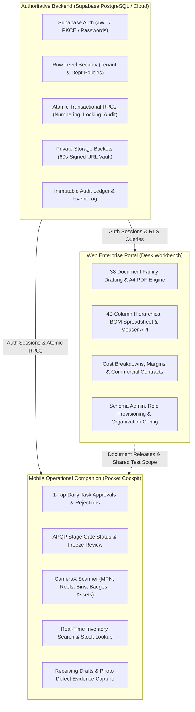

# SSM One — Unified Complete Portal & Mobile Handoff Specification

**Document Version:** 3.0 (Consolidated Authoritative Master Specification)  
**Date:** 20 October 2026  
**Ecosystem Repositories:**  
- Web Portal: `ssm-new-web` (TanStack Start / React 19 / Vite / Tailwind)
- Mobile Application: `SSM-new-app` (Android Kotlin / Jetpack Compose / Room)
- Authoritative Backend: Supabase Cloud (`rzskhndweihuczbdhoxk`) PostgreSQL with Row-Level Security (RLS)

---

## 1. Executive Summary & Architectural Vision

The **SSM One Enterprise Platform** is a specialized Automotive Supply Chain & Production Management System (SCMS) adhering to **IATF 16949**, **ISO 9001**, and **VDA 6.3 / APQP** standards. It manages the complete product lifecycle from initial commercial RFP/RFQ intake, through 9 rigorous stage gates, component procurement, multi-level BOM tracking, electronics/mechanical manufacturing, to final customer OEM vehicle integration (e.g. Tata Motors Fleet Solutions).

### 1.1 The Non-Negotiable System Authority Split



---

## 2. Platform Boundaries: Mobile Companion vs. Web Authoritative

The core design principle across both repositories is:
> **"Mobile for Action on the Move; Web for Deep Authoring at the Desk"**

### 2.1 What Belongs on the Mobile Companion
- **High-Frequency Action**: 1-tap approvals/rejections of daily tasks, work orders, and department sign-offs.
- **Decision Gates**: Reviewing high-level stage gate readiness and signing off on APQP phase freezes.
- **On-Site Physical Capture**: CameraX QR and barcode scanning, receiving draft voucher logging at the dock, photo capture of prototype defects or machine stoppages.
- **Fast Search**: Instant filtering of inventory stock by MPN, description, manufacturer, or storage bin coordinate.
- **Uncluttered Experience**: Avoids megatables, eliminates secondary administrative tabs, and enforces thumb-friendly navigation.

### 2.2 What Belongs Exclusively on the Web Portal
- **Deep Document Drafting**: Full 38-family document authoring, revision histories, multi-section A4 PDF compilation.
- **Complex Engineering Spreadsheets**: 40-column hierarchical BOM grids, parametric component crawlers, alternate component comparison matrices.
- **Financial & Commercial Negotiation**: Proprietary cost breakdowns, profit margins, volume discounts, vendor quote comparison matrices.
- **Database & System Administration**: Database migrations, RLS policy management, enterprise role provisioning, raw telemetry consoles.

---

## 3. Complete 14-Department Operational Responsibility Matrix

The system governs 14 roles (Executive Admin, Tata Motors OEM Client, and 12 Enterprise Departments):

| # | Department Code & Name | Mobile App Scope (Action on the Move) | Web Portal Scope (Authoring & Administration) | Excluded from Mobile to Prevent Clutter |
| :- | :--- | :--- | :--- | :--- |
| **1** | **ADMIN** (Executive Command / MD) | • Critical Stage Gate 1–9 freeze sign-off<br>• High-value deal & CapEx approvals<br>• Cross-department bottleneck alert summary | • Enterprise settings & global policy authoring<br>• Master organization structure & permissions<br>• Comprehensive audit trail investigation | Raw SQL consoles, database migration tools, low-level server configuration |
| **2** | **CLIENT** (Tata Motors OEM Portal) | • Stage milestone acceptance & feedback<br>• Prototype dispatch delivery confirmation<br>• High-level project timeline overview | • Formal contract & statement of work (SOW) review<br>• Change request formal submission & negotiation<br>• Full engineering compliance dossier inspection | Internal cost breakdowns, proprietary supplier vendor lists, raw margins |
| **3** | **SAL** (Sales & Business Development) | • 1-tap Feasibility Review sign-off<br>• Stage 1 & 2 Deal approvals<br>• Customer contact directory & pipeline stage | • Detailed quotation authoring & price breakdown<br>• Commercial contract draft & redlining<br>• Profit margin and volume tier calculations | Financial margin spreadsheets, multi-page customer contract text editors |
| **4** | **EHW** (Hardware Engineering) | • Component inventory search & bin location<br>• Stock match review (Available vs Shortage)<br>• 1-tap schematic & layout review sign-off<br>• ECR / ECO approval queue | • Multi-sheet schematic & Gerber authoring<br>• Full 40-column BOM engineering spreadsheet<br>• Component alternative parametric comparison<br>• Thermal & signal integrity reports | Heavy CAD schematic viewers, massive 500-line unformatted BOM tables |
| **5** | **FW** (Firmware Engineering) | • Build approval & release gate review<br>• Flash programming checklist sign-off<br>• Bootloader version verification badge | • Git commit history & PR diff review<br>• Memory map & register configuration matrices<br>• Static analysis & MISRA compliance logs | In-app code editors, hex dump inspections, terminal build consoles |
| **6** | **SW** (Software Engineering) | • Daily task approval & board overview<br>• Mobile app & Cloud release sign-off<br>• API deployment status badge | • Database schema & API endpoint configuration<br>• Cloud architecture diagram authoring<br>• Deep telemetry & error log drill-down | Full API payload builders, complex database migration consoles |
| **7** | **MECH** (Mechanical Engineering) | • Enclosure fit & 3D sample sign-off<br>• Photo upload of physical test prototypes<br>• Tooling trial review approvals | • 3D CAD STEP/IGES model rendering & analysis<br>• Mold design tolerance & shrinkage spreadsheets<br>• CMM inspection coordinate reports | Heavy 3D WebGL CAD viewers, detailed dimension spreadsheets |
| **8** | **PUR** (Purchasing & SCM) | • Urgent PO sign-off & escalation queue<br>• Receiving draft creation via ASN barcode scan<br>• Part shortage alert review | • Vendor quotation comparison matrices<br>• Supplier payment terms & banking administration<br>• Global shipping & freight customs documentation | Vendor bank setup, multi-vendor pricing matrices, raw PO tax calculation |
| **9** | **QA** (Quality Assurance & APQP) | • IQC receiving inspection pass/hold tag<br>• Rapid defect logging with camera photo<br>• Stage-gate freeze sign-off & PPAP checklist | • 8D root-cause investigation authoring<br>• Full PFMEA / DFMEA risk priority matrix<br>• Gauge R&R and statistical process control (SPC) | Complex 50-row FMEA spreadsheets, statistical curve generators |
| **10** | **EMF** (Electronics Manufacturing) | • SMT reel barcode scan & feeder assignment<br>• Work traveler check-in / step completion<br>• Stencil wipe & reflow oven checklist sign-off | • SMT pick-and-place coordinate programming<br>• Production yield & scrap statistical trend charts<br>• Line balance & cycle time optimization models | Machine G-code / placement file loaders, cycle time simulation |
| **11** | **MMF** (Mechanical Manufacturing) | • CNC / stamping machine status toggle<br>• Rapid breakdown ticket logging<br>• Tool wear & lubrication daily check | • Tooling lifespan & sharpening lifecycle tracking<br>• Preventive maintenance master schedule<br>• Vendor spare parts procurement schedule | Master facility Gantt charts, deep machine telemetry diagnostics |
| **12** | **FIN** (Accounts & Finance) | • Capital expenditure (CapEx) PO approval<br>• Invoice payment release authorization<br>• Daily project budget burn summary | • General ledger reconciliation & balance sheet<br>• GST / Tax audit filings & e-invoicing<br>• Comprehensive project P&L and cash flow reports | Ledger account mapping, double-entry journal forms, tax returns |
| **13** | **SIT** (Service & IT Infrastructure) | • Urgent server/network outage alert push<br>• Physical asset quick scan & audit tag<br>• Security badge & laptop check-out | • Network topology & firewall rule management<br>• Active Directory / SSO provisioning console<br>• Cloud server infrastructure cost dashboards | Cloud CLI consoles, firewall routing tables, SSH terminals |
| **14** | **HROPS** (HR & Operations) | • Urgent leave request approval<br>• Operator station qualification scan<br>• Incident / safety hazard quick report | • Monthly payroll computation & deductions<br>• Full employee training & competency matrix<br>• Statutory compliance & labor law documentation | Full payroll spreadsheets, confidential salary review grids |

---

## 4. Unified User Authentication & Shared Demo Accounts

Both Web and Android use an identical, shared test user base:

| Dept Code | Role Title | Lead Persona | Demo Email | Demo Password | Default Authority |
| :--- | :--- | :--- | :--- | :--- | :--- |
| **ADMIN** | Executive Admin / MD | Executive Admin | `admin@example.com` | `Admin@Demo2026` | Global Sign-Off, Gate Advances, CapEx |
| **CLIENT** | Tata Motors OEM Portal | Rohan Verma | `rohan.verma@example.com` | `Tata@Client2026` | Client Acceptance, Milestones |
| **SAL** | Sales & Business Development | Priya Sharma | `priya.sharma@example.com` | `Demo@SAL2026` | Feasibility Sign-Off, Commercial Deals |
| **EHW** | Hardware Engineering | Avery Vale | `avery.vale@example.com` | `Demo@EHW2026` | Schematics, Stock Match, ECRs |
| **FW** | Firmware Engineering | Devon Lane | `devon.lane@example.com` | `Demo@EFW2026` | Firmware Builds, Bootloaders, Checklists |
| **SW** | Software Engineering | Siddharth Roy | `siddharth.roy@example.com` | `Demo@CSW2026` | Cloud APIs, Apps, System Integration |
| **MECH** | Mechanical Engineering | Samira Holt | `samira.holt@example.com` | `Demo@MECH2026` | Enclosures, Thermal Specs, Tooling |
| **PUR** | Purchasing & SCM | Morgan Reed | `morgan.reed@example.com` | `Demo@PUR2026` | Purchase Orders, RFQs, Stock Triage |
| **QA** | Quality Assurance & APQP | Jordan Blake | `jordan.blake@example.com` | `Demo@QA2026` | IQC Holds, NCRs, 8D, PPAP Sign-Off |
| **EMF** | Electronics Manufacturing | Casey Rowan | `casey.rowan@example.com` | `Demo@EMF2026` | Travelers, SMT Feeder Scans, DFM |
| **MMF** | Mechanical Tooling | Marcus Vance | `mmf.lead@example.com` | `Demo@MMF2026` | Machine Checklists, Tool Wear |
| **FIN** | Accounts & Finance | Priya Voss | `priya.voss@example.com` | `Demo@FIN2026` | Invoice Releases, CapEx POs, Budgets |
| **SIT** | Service & IT | Kai Morgan | `kai.morgan@example.com` | `Demo@SIT2026` | IT Tickets, Infrastructure, Asset Tags |
| **HROPS** | HR & Operations | Taylor Quinn | `taylor.quinn@example.com` | `Demo@HR2026` | Leaves, Shift Qualifications, Safety |

### 4.1 Authentication Protocols
1. **Online Enterprise Protocol**: Calls Supabase Cloud `/auth/v1/token?grant_type=password` with API key headers. Tokens are saved strictly in Android Keystore / `EncryptedSharedPreferences` (mobile) or secure HTTP-only cookies / local storage (web).
2. **Offline Demo Fallback**: When offline or in local demo mode, a fully structured `AuthSession` is provisioned with authentic metadata (`leadName`, `role`, `department`), immediately binding to the local session repository.
3. **Actor Derivation Rule**: The backend strictly derives the acting user from `auth.uid()` of the authenticated session. Callers cannot supply arbitrary user IDs in mutation payloads.

---

## 5. 9-Stage Automotive APQP / Stage-Gate Lifecycle Contract

The platform enforces 9 chronological APQP stages:

```
Stage 1: Lead & Customer Inquiry
Stage 2: Feasibility & Commercial Proposal (Stage Gate 2 Freeze: Contract Review)
Stage 3: System Requirements & Architecture (Stage Gate 3 Freeze: Domain Specs)
Stage 4: Detailed Hardware & Software Design (Stage Gate 4 Freeze: Hardware Schematic)
Stage 5: Procurement & Prototype Build (Stage Gate 5 Freeze: BOM Verification)
Stage 6: Engineering Verification & Pilot Build (Stage Gate 6 Freeze: DVP&R Sign-Off)
Stage 7: Production Part Approval Process (PPAP / PSW Sign-Off)
Stage 8: Mass Production & SMT Ramp-Up
Stage 9: Sustaining Engineering & EOL
```

### 5.1 Authoritative Gate Advancement RPC Contract
Gate advances must be executed through the authoritative RPC (`execute_operational_stage_gate` / `advance_stage_gate_authoritative`). Direct table writes to project stage columns are denied by backend RLS.

#### Mandatory Freeze Rules:
1. **Revision-Bound Approvals**: Gate advancement requires valid signed approvals bound to the exact active revision and content checksum of the deliverable document.
2. **Cryptographic SHA-256 Binding**: Stale approvals signed against previous file versions cannot satisfy a freeze.
3. **Hermetic Project Isolation**: An approval or evidence document from Project A cannot satisfy a requirement for Project B, even within the same organization.
4. **Strict Signing Authority**: Only designated department leads with verified capability can sign off on gate prerequisites (e.g., Sales Lead for Contract Review; Hardware Lead for Schematics; QA Lead for PPAP/PSW). Cross-department leads or viewers fail closed.
5. **Approved N/A Rationale**: If a domain deliverable is not applicable, it must have a requirement-specific, bound approval with explicit N/A justification.

---

## 6. The 38-Family Automotive Controlled Document Catalogue

Documents belong to 5 high-level domains:

### Commercial & Requirements (COM_01–COM_08)
- `COM_01`: Customer Requirements Document (CRD / SOR)
- `COM_02`: Engineering Feasibility Review Sheet (DFM/DFA)
- `COM_03`: Formal Quotation & Cost Breakdown (CBD)
- `COM_04`: Customer Purchase Order (PO) & Contract
- `COM_05`: Statement of Work (SOW)
- `COM_06`: Technical Clarification Matrix (TCM)
- `COM_07`: Commercial Risk Register
- `COM_08`: Customer Sign-off Certificate

### Engineering & Design (ENG_01–ENG_14)
- `ENG_01`: System Architecture Design Document (SADD)
- `ENG_02`: Hardware Schematic Diagram (SCH)
- `ENG_03`: PCB Layout & Gerber Package
- `ENG_04`: Engineering Bill of Materials (EBOM)
- `ENG_05`: Firmware Architecture & Register Map
- `ENG_06`: Software API Specification & ICD
- `ENG_07`: Mechanical 3D CAD Assembly (STEP/IGES)
- `ENG_08`: Enclosure 2D Manufacturing Drawing
- `ENG_09`: Wire Harness & Pinout Drawing
- `ENG_10`: Design Failure Mode and Effects Analysis (DFMEA)
- `ENG_11`: Thermal & Power Simulation Report
- `ENG_12`: Engineering Change Request (ECR)
- `ENG_13`: Engineering Change Order (ECO)
- `ENG_14`: Component Derating & Stress Analysis

### Quality & Testing (QA_01–QA_08)
- `QA_01`: Quality Control Plan (QCP)
- `QA_02`: Process Failure Mode and Effects Analysis (PFMEA)
- `QA_03`: Production Part Approval Process (PPAP / PSW)
- `QA_04`: Design Verification Plan & Report (DVP&R)
- `QA_05`: Incoming Quality Control (IQC) Report
- `QA_06`: In-Process Quality Audit Sheet
- `QA_07`: Non-Conformance Report (NCR)
- `QA_08`: 8D Root Cause Corrective Action (CAPA)

### Production & Manufacturing (PRD_01–PRD_05)
- `PRD_01`: Standard Operating Procedure (SOP)
- `PRD_02`: Manufacturing Routing & Work Traveler
- `PRD_03`: SMT Stencil & Feeder Setup Sheet
- `PRD_04`: End-of-Line (EOL) Automated Test Specification
- `PRD_05`: Packaging & Palletization Standard

### Operations, IT & Facilities (OPS_01–OPS_03)
- `OPS_01`: Preventive Maintenance (PM) Checklist
- `OPS_02`: Tooling & Jig Calibration Certificate
- `OPS_03`: Workplace Safety & Gatehouse Pass Register

### 6.1 Private Storage Vault Contract
- File uploads are placed into private, non-public Supabase storage buckets (`controlled-documents`).
- Delivery is performed strictly through **60-second expiring signed URLs** generated via backend storage API (`/storage/v1/object/sign/`).
- Plaintext public URLs are prohibited.

---

## 7. Governed Inventory & Material Transactions

Inventory operations follow strict automotive traceability rules:

### 7.1 Real-Time Component Lookup
- Components are searchable instantly by **MPN**, **Description**, **Manufacturer**, **Category**, **Storage Location**, and **Bin Coordinate**.
- Status is classified into three authoritative states:
  - **Available**: Released stock on hand ready for project issuance.
  - **Quarantine / IQC Hold**: Awaiting incoming inspection disposition.
  - **Allocated / Reserved**: Committed to an active project work order.

### 7.2 Transaction Atomicity & Idempotency
Critical stock mutations require client-generated UUID idempotency tokens (`request_key`) and invoke dedicated server RPCs:
1. **Goods Receipt (GRN)**: `create_grn` (Generates server sequential GRN number; logs vendor lot, date code, MSL status).
2. **Material Issue**: `post_material_issue` (Deducts stock atomically against a valid project work order; logs actor).
3. **Material Return**: `post_material_return` (Prevents over-return; verifies original issuance).
4. **Stock Adjustment & Transfer**: `post_stock_transfer`, `post_stock_adjustment` (Requires managerial approval and audit log).

---

## 8. Client OEM Intake & Reviewer Contract

### 8.1 Workflow Boundary
1. **Intake Creation**: Sales Lead creates commercial enquiries mapped to valid customer contacts and projects.
2. **Engineering Assignment**: Technical requirements are assigned to domain leads (EHW, FW, SW, MECH) for feasibility review.
3. **Engineering Feasibility Response**: Domain leads mark technical parameters as Feasible, Feasible with Deviation, or Infeasible, attaching evidence.
4. **Client OEM Portal**: Tata Motors OEM client reviews the consolidated feasibility summary, milestone timeline, and provides formal acceptance.

---

## 9. Offline Engine & Sync Coordination (Mobile)

### 9.1 Action Classification
- **`OFFLINE_SAFE`**: Reading cached Room database records (component specs, task lists, contacts).
- **`OFFLINE_DRAFT_ONLY`**: Creating local draft receiving vouchers, recording local defect photos. Drafts remain in local pending queues; no stock or gate transitions occur offline.
- **`ONLINE_REQUIRED`**: Critical state mutations (Final GRN, Material Issue, Gate Advancement, Document Release). If network is absent, the user is blocked with an explicit *"Network Connection Required"* dialog.

---

## 10. Summary of Consolidations

This unified document permanently consolidates and supersedes the following fragmented interim notes:
- `ANDROID_ANTIGRAVITY_HANDOFF.md`
- `ANTIGRAVITY_PORTAL_COMPLETION_HANDOFF_2026-10-19.md`
- `ANTIGRAVITY_SYNC_STATUS.md`
- `department_workspace_ui_refinement_plan.md`
- `DOCUMENT_STANDARDIZATION_PLAN.md`
- `master_portal_and_mobile_comprehensive_plan_reviewed.md`
- `operational-gate-revision-verification.md`
- `shared-test-workspace.md`
- `CLIENT_REQUIREMENT_REVIEWER_CONTRACT_2026-10-06.md`
- `HLPL-AI4T-QA-DOCCTRL-00.md`
- `SCMS_PORTAL_FEATURES_KNOWLEDGE_BASE.md`
- `MOBILE_BACKEND_CONTRACT.md`
- All loose root markdown stubs and unapplied early October SQL drafts.

## Latest scoped record-flow verification addendum — 25 October 2026

The [consolidated handoff, section 14](ANTIGRAVITY_READY_TO_USE_CONSOLIDATED_HANDOFF_2026-10-21.md) expands the master plan with the latest accepted discussion requirements, source/standards boundaries and complete record-flow verification programme. Read it before interpreting older generic forms or approval/reference assumptions as final. Preserve compatible functionality and follow the latest explicit human decisions. Use the single execution prompt at its end; do not duplicate this as a separate batch.